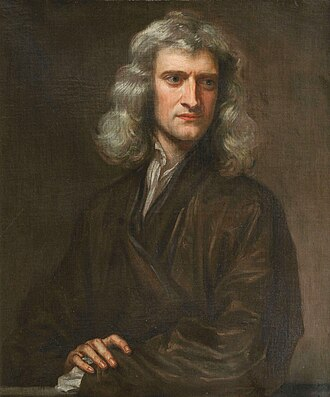
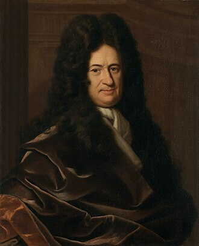

Autobus jezdí každých deset minut a vy přijdete na zastávku v náhodnou chvíli. Jaká je pravděpodobnost, že budete čekat právě 4 minuty? Přesně $4{,}000000\ldots$ minuty? Ne, **nulová**. Že budete čekat mezi 4 a 6 minutami? Pětinová. U veličin, které mění hodnotu plynule (čas, výška, hmotnost, teplota), se pravděpodobnost přestává přiřazovat jednotlivým hodnotám a začíná se přiřazovat **intervalům**.

[Spojitá náhodná veličina]{.highlight-term} může nabýt libovolné hodnoty z nějakého intervalu, mezi dvěma hodnotami vždy leží další. Pro takovou veličinu se místo sloupců pravděpodobností $p_k$ používá křivka, hustota.

```{ojs}
//| echo: false
import {C, plotStyle} from "../assets/jhrules.js"
```

```{ojs}
//| echo: false
import {columnWidth, animation, drawText, clamp, ease, makeButton} from "../assets/anim.js"
```

```{ojs}
//| echo: false
// šířka textového sloupce místo vestavěné šířky celé plochy (grafy jinak přetékají doprava)
width = columnWidth(Generators)
```

```{ojs}
//| echo: false
// dvě rovnoměrná rozdělení pro ukázky o hustotě, distribuční a kvantilové funkci
distDefs5 = ({
  "Rovnoměrná (čekání na autobus 0 až 10 min)": {
    dom: [-1, 11], qdom: [0, 10], range: [0, 10], step: 0.25, a0: 3, b0: 7, label: "doba čekání x (min)", supp: [0, 10], h: 0.1,
    pdf: (x) => x >= 0 && x <= 10 ? 0.1 : 0,
    cdf: (x) => x < 0 ? 0 : x > 10 ? 1 : x / 10,
    sample: () => 10 * Math.random()
  },
  "Rovnoměrná (dokončení úkolu 0 až 0,5 h)": {
    dom: [-0.05, 0.55], qdom: [0, 0.5], range: [0, 0.5], step: 0.01, a0: 0.1, b0: 0.3, label: "doba x (h)", supp: [0, 0.5], h: 2,
    pdf: (x) => x >= 0 && x <= 0.5 ? 2 : 0,
    cdf: (x) => x < 0 ? 0 : x > 0.5 ? 1 : 2 * x,
    sample: () => 0.5 * Math.random()
  }
})

distNames5 = Object.keys(distDefs5)
distBus5 = distDefs5[distNames5[0]]

// hustota rovnoměrného rozdělení je nespojitá: kreslí se jako samostatné úsečky bez svislých spojnic.
// V krajních bodech nosiče má funkce hodnotu h (plné kolečko), limita z druhé strany je 0 (prázdné kolečko).
pdfPieces5 = (d) => ({
  segs: [[d.dom[0], d.supp[0], 0], [d.supp[0], d.supp[1], d.h], [d.supp[1], d.dom[1], 0]],
  filled: [[d.supp[0], d.h], [d.supp[1], d.h]],
  open: [[d.supp[0], 0], [d.supp[1], 0]]
})

// kvantilová funkce půlením intervalu (distribuční funkce je neklesající)
quant5 = (d, p) => {
  let lo = d.qdom[0], hi = d.qdom[1];
  for (let i = 0; i < 80; i++) {
    const mid = (lo + hi) / 2;
    if (d.cdf(mid) < p) lo = mid; else hi = mid;
  }
  return (lo + hi) / 2;
}

cz5 = (x, d = 3) => x.toFixed(d).replace(".", ",")
```

## Od histogramu k hustotě

Vraťme se k autobusu. Doba čekání $X$ je mezi $0$ a $10$ minutami a žádná hodnota není pravděpodobnější než jiná. U diskrétní veličiny je výška sloupce přímo pravděpodobnost. U spojité to nejde, protože každá přesná hodnota má pravděpodobnost nulovou. Proto se nad hodnotami skládají sloupce **intervalů** a jako pravděpodobnost se bere jejich **plocha**. Aby byl součet ploch všech sloupců roven $1$, musí být výška sloupce

$$f_j = \frac{n_j}{n\cdot h},$$

kde $n_j$ je počet pozorování v $j$-tém intervalu, $n$ počet všech pozorování a $h$ šířka intervalu. Takovému histogramu se říká histogram v hustotním měřítku.

::: {.callout-note}
## Jak číst ukázku
Pozorování doby čekání padají do intervalů. Zužujte intervaly a sledujte, jak sloupce kopírují vodorovnou oranžovou čáru. Té se říká [hustota pravděpodobnosti]{.highlight-term} (probability density function, PDF) a značí se $f(x)$. Pro autobus je $f(x)=0{,}1$, protože na intervalu délky $10$ musí být plocha rovna $1$. Hustota je v bodech $0$ a $10$ nespojitá: plné kolečko značí, že tam funkce má danou hodnotu, prázdné kolečko, že ji tam nemá (je to jen limita z druhé strany). Hodnota hustoty v jediném bodě pravděpodobnost nemění.
:::

```{ojs}
//| echo: false
//| classes: rez-400
{
  const d = distBus5;
  const H = 320, L0 = 52, top = 26, bot = H - 40, maxN = 5000;
  const R1 = width - 20;
  const xOf = (x) => L0 + (R1 - L0) * (x - d.dom[0]) / (d.dom[1] - d.dom[0]);
  const grid = d3.range(d.dom[0], d.dom[1] + 1e-9, (d.dom[1] - d.dom[0]) / 300);
  const fmax = d3.max(grid, d.pdf) * 1.3;
  const yOf = (v) => bot - (bot - top) * v / fmax;

  let toggleBtn;
  return animation({
    width, height: H, buttons: false,
    setup: (prev) => ({xs: [], bins: prev ? prev.bins : 25}),
    step: (s) => {
      const k = s.xs.length < 50 ? 1 : s.xs.length < 300 ? 5 : 25;
      for (let i = 0; i < k && s.xs.length < maxN; i++) s.xs.push(d.sample());
    },
    controls: (ctl) => {
      const box = document.createElement("div");
      box.style.cssText = "display:flex;gap:8px;flex-wrap:wrap;align-items:center";
      const add = (k) => { ctl.running = false; for (let i = 0; i < k && ctl.state.xs.length < maxN; i++) ctl.state.xs.push(d.sample()); ctl.redraw(); };
      toggleBtn = makeButton("Plynule", () => { ctl.running = !ctl.running; });
      const bins = Inputs.range([3, 80], {step: 1, value: ctl.state.bins, label: "Počet intervalů"});
      bins.addEventListener("input", () => { ctl.state.bins = +bins.value; ctl.redraw(); });
      box.append(toggleBtn, makeButton("+10", () => add(10)), makeButton("+100", () => add(100)),
                 makeButton("Restart", () => ctl.reset()), bins);
      return box;
    },
    draw: (ctx, s) => {
      const n = s.xs.length, bw = (d.dom[1] - d.dom[0]) / s.bins;
      const counts = new Array(s.bins).fill(0);
      for (const x of s.xs) {
        const b = Math.floor((x - d.dom[0]) / bw);
        if (b >= 0 && b < s.bins) counts[b]++;
      }
      // osa y: hustota
      for (const v of [0, fmax / 1.3 / 2, fmax / 1.3]) {
        ctx.strokeStyle = C.grid; ctx.lineWidth = 1;
        ctx.beginPath(); ctx.moveTo(L0, yOf(v)); ctx.lineTo(R1, yOf(v)); ctx.stroke();
        drawText(ctx, v.toFixed(3).replace(".", ","), L0 - 8, yOf(v) + 4, {align: "right", size: 11});
      }
      drawText(ctx, "hustota f(x)", L0, 16, {bold: true});
      // pás hustoty nad 1 (pod sloupci, ať je nevybledí)
      if (fmax / 1.3 > 1) {
        ctx.fillStyle = C.contextLight; ctx.globalAlpha = 0.35;
        ctx.fillRect(L0, top, R1 - L0, yOf(1) - top);
        ctx.globalAlpha = 1;
      }
      // sloupce
      counts.forEach((c, b) => {
        const h = n ? c / (n * bw) : 0;
        ctx.fillStyle = C.primary;
        ctx.fillRect(xOf(d.dom[0] + b * bw), yOf(h), xOf(d.dom[0] + bw) - xOf(d.dom[0]), bot - yOf(h));
        ctx.strokeStyle = C.bg; ctx.lineWidth = 1.5;
        ctx.strokeRect(xOf(d.dom[0] + b * bw), yOf(h), xOf(d.dom[0] + bw) - xOf(d.dom[0]), bot - yOf(h));
      });
      // osa x
      ctx.strokeStyle = C.context; ctx.lineWidth = 1.5;
      ctx.beginPath(); ctx.moveTo(L0, bot); ctx.lineTo(R1, bot); ctx.stroke();
      for (const x of d3.ticks(d.dom[0], d.dom[1], 6)) drawText(ctx, String(x), xOf(x), bot + 16, {align: "center"});
      drawText(ctx, d.label, (L0 + R1) / 2, bot + 32, {align: "center"});
      // teoretická hustota je nespojitá: úsečky bez svislých spojnic, plné kolečko (hodnota platí) a prázdné (limita z druhé strany)
      const pc = pdfPieces5(d);
      ctx.strokeStyle = C.accent; ctx.lineWidth = 2.5;
      for (const [x1, x2, y] of pc.segs) {
        ctx.beginPath(); ctx.moveTo(xOf(x1), yOf(y)); ctx.lineTo(xOf(x2), yOf(y)); ctx.stroke();
      }
      const dotAt = (x, y, filled) => {
        ctx.beginPath(); ctx.arc(xOf(x), yOf(y), 4.5, 0, 2 * Math.PI);
        ctx.fillStyle = filled ? C.accent : C.bg; ctx.fill();
        ctx.lineWidth = 2; ctx.strokeStyle = C.accent; ctx.stroke();
      };
      pc.open.forEach(([x, y]) => dotAt(x, y, false));
      pc.filled.forEach(([x, y]) => dotAt(x, y, true));
      // hustota nad 1: vyznačený pás, aby bylo vidět, že hustota není pravděpodobnost
      if (fmax / 1.3 > 1) {
        ctx.strokeStyle = C.text; ctx.lineWidth = 1.2; ctx.setLineDash([6, 4]);
        ctx.beginPath(); ctx.moveTo(L0, yOf(1)); ctx.lineTo(R1, yOf(1)); ctx.stroke();
        ctx.setLineDash([]);
        drawText(ctx, "hustota = 1", R1 - 6, yOf(1) + 14, {align: "right", bold: true, size: 11});
        drawText(ctx, "y>1  je v pořádku, protože hodnoty funkce hustoty neurčují pravděpodobnost", L0 + 8, top + 14, {bold: true, size: 12});
      }
    },
    readout: (s, ctl) => {
      toggleBtn.textContent = ctl.running ? "Pauza" : "Plynule";
      const bw = (d.dom[1] - d.dom[0]) / s.bins;
      const peak = d3.max(grid, d.pdf);
      return `n = ${s.xs.length} pozorování, šířka intervalu ${cz5(bw, 3)}. Plocha všech sloupců je 1, plocha pod oranžovou křivkou také.` +
        ` Vrchol hustoty je ${cz5(peak, 2)}` + (peak > 1 ? ", tedy větší než 1: není to pravděpodobnost, pravděpodobnost je plocha." : ", plocha pod křivkou je přesto 1.");
    }
  });
}
```


## Hustota a distribuční funkce

Hustota $f(x)$ je nezáporná křivka s plochou pod ní rovnou $1$. Pravděpodobnost intervalu je plocha pod křivkou nad ním

$$P(a\leq X\leq b)=\int_a^b f(x)\,dx = F(b)-F(a).$$

Plochu pod křivkou umíme počítat díky integrálnímu počtu, který v 17. století rozvinuli [Isaac Newton (1643–1727)]{.smallcaps} a [Gottfried Wilhelm Leibniz (1646–1716)]{.smallcaps}.

::: {.column-margin .osobnost}


**Isaac Newton**
*1643 – 1727, Anglie*

Anglický fyzik a matematik. Integrální a diferenciální počet rozvinul nezávisle na Leibnizovi.
<small>Portrét: Wikimedia Commons, volné dílo</small>
:::

::: {.column-margin .osobnost}


**Gottfried Wilhelm Leibniz**
*1646 – 1716, Německo*

Německý filozof a matematik. Zavedl značku integrálu $\int$, kterou používáme dodnes.
<small>Portrét: Wikimedia Commons, volné dílo</small>
:::

::: {.callout-note .zapamatuj}
## Zapamatujte si
U spojité veličiny je pravděpodobnost **plocha pod hustotou** nad intervalem. Pravděpodobnost jedné přesné hodnoty je nulová.
:::

Plocha nad jediným bodem je nulová, takže $P(X=a)=0$ a nezáleží na tom, jestli je v nerovnostech $<$ nebo $\leq$. Distribuční funkce $F(x)=P(X\leq x)$ je plocha pod hustotou **až do** $x$. Je neklesající, začíná v $0$ a končí v $1$, a tentokrát je spojitá (nemá schody). U autobusu je $F(x)=x/10$, tedy $P(4\leq X\leq 6)=F(6)-F(4)=0{,}2$.

::: {.callout-warning}
## Pozor: hustota není pravděpodobnost
Hustota $f(x)$ **není pravděpodobnost**: může být větší než $1$ (u veličiny s malým rozptylem je křivka úzká a vysoká). Pravděpodobností jsou až plochy pod ní. Vyzkoušejte to v ukázce níže na rozdělení *dokončení úkolu 0 až 0,5 h*: hustota je tam $2$ a přesto je plocha pod křivkou pořád jen $1$.
:::

::: {.callout-note}
## Jak číst ukázku
Nahoře je plocha pod hustotou mezi $a$ a $b$, dole distribuční funkce: pravděpodobnost je **rozdíl** $F(b)-F(a)$. Zkuste interval zúžit až do jediného bodu a sledujte, že pravděpodobnost klesá k nule.
:::

```{ojs}
//| echo: false
//| classes: rez-slider-3
viewof distB5 = Inputs.select(distNames5, {label: "Rozdělení"})
dB5 = distDefs5[distB5]
viewof a5 = Inputs.range(dB5.range, {step: dB5.step, value: dB5.a0, label: "mez a"})
viewof b5 = Inputs.range(dB5.range, {step: dB5.step, value: dB5.b0, label: "mez b"})
```

```{ojs}
//| echo: false
//| classes: rez-560
{
  const d = dB5;
  const lo = Math.min(a5, b5), hi = Math.max(a5, b5);
  const xs = d3.range(d.dom[0], d.dom[1] + 1e-9, (d.dom[1] - d.dom[0]) / 300);
  const shade = d3.range(lo, hi + 1e-9, Math.max((hi - lo) / 100, 1e-6));
  const fLo = d.cdf(lo), fHi = d.cdf(hi);
  const fm = d3.max(xs, d.pdf);
  const pc = pdfPieces5(d);
  const top = Plot.plot({
    width, height: 220, style: plotStyle, marginLeft: 50,
    x: {domain: d.dom, label: d.label},
    y: {grid: true, label: "hustota f(x)"},
    marks: [
      // hustota nad 1: pás a čára, aby bylo vidět, že hustota není pravděpodobnost
      ...(fm > 1 ? [
        Plot.rect([{y1: 1, y2: fm * 1.05}], {x1: d.dom[0], x2: d.dom[1], y1: "y1", y2: "y2", fill: C.contextLight, fillOpacity: 0.35}),
        Plot.ruleY([1], {stroke: C.text, strokeDasharray: "5,4"}),
        Plot.text([{x: d.dom[1], y: 1}], {x: "x", y: "y", text: ["hustota = 1"], textAnchor: "end", dy: 12, fontWeight: "bold", fontSize: 11})
      ] : []),
      Plot.areaY(shade, {x: (x) => x, y: d.pdf, fill: C.primaryLight, fillOpacity: 0.9}),
      // nespojitá hustota: úsečky, plná kolečka (v bodě platí hodnota) a prázdná (limita z druhé strany)
      Plot.ruleY(pc.segs, {x1: (p) => p[0], x2: (p) => p[1], y: (p) => p[2], stroke: C.accent, strokeWidth: 2}),
      Plot.dot(pc.open, {x: (p) => p[0], y: (p) => p[1], fill: C.bg, stroke: C.accent, strokeWidth: 2, r: 4.5}),
      Plot.dot(pc.filled, {x: (p) => p[0], y: (p) => p[1], fill: C.accent, stroke: C.accent, r: 4.5}),
      Plot.ruleX([lo, hi], {stroke: C.text, strokeDasharray: "4,3"}),
      Plot.ruleY([0], {stroke: C.context})
    ]
  });
  const bottom = Plot.plot({
    width, height: 220, style: plotStyle, marginLeft: 50,
    x: {domain: d.dom, label: d.label},
    y: {grid: true, label: "distribuční funkce F(x)", domain: [0, 1]},
    marks: [
      Plot.line(xs, {x: (x) => x, y: d.cdf, stroke: C.accent, strokeWidth: 2}),
      Plot.link([{x: lo, y: fLo}, {x: hi, y: fHi}], {x1: d.dom[0], x2: "x", y1: "y", y2: "y", stroke: C.context, strokeDasharray: "4,3"}),
      Plot.dot([{x: lo, y: fLo}, {x: hi, y: fHi}], {x: "x", y: "y", r: 5, fill: C.text}),
      Plot.link([{y1: fLo, y2: fHi}], {x1: d.dom[0], x2: d.dom[0], y1: "y1", y2: "y2", stroke: C.primary, strokeWidth: 5}),
      Plot.ruleY([0], {stroke: C.context})
    ]
  });
  // výška popisů je pevná, ať stránka neskáče při tažení posuvníku nebo změně rozdělení
  return html`${top}${bottom}
    <div style="font-size:14px;min-height:3.2em">P(${cz5(lo, 2)} ≤ X ≤ ${cz5(hi, 2)}) = F(${cz5(hi, 2)}) − F(${cz5(lo, 2)}) = ${cz5(fHi)} − ${cz5(fLo)} =
    <b>${cz5(fHi - fLo)}</b>. Pravděpodobnost přesné hodnoty je nulová: P(X = ${cz5(lo, 2)}) = 0.</div>
    <div style="font-size:14px;margin-top:8px;padding:6px 10px;box-sizing:border-box;min-height:5.5em;border-left:5px solid ${fm > 1 ? C.primary : "transparent"};background:${fm > 1 ? C.contextLight + "59" : "transparent"}">
      ${fm > 1 ? html`<b>Pozor:</b> hustota zde dosahuje ${cz5(fm, 2)}, je tedy <b>větší než 1</b>. Hustota není pravděpodobnost, ta nemůže přesáhnout 1.
      Pravděpodobností je až <b>plocha</b> pod křivkou, a ta je vždy nejvýše 1.` : html`<span style="color:${C.context}">Vrchol hustoty je ${cz5(fm, 2)}, tedy menší než 1.</span>`}</div>`;
}
```


## Kvantilová funkce

Distribuční funkce odpovídá na otázku „jaká je pravděpodobnost, že $X\le x$?“. **Kvantilová funkce** je obrácená otázka: „pod jakou hodnotu spadne přesně podíl $p$ všech pozorování?“. Je to inverzní funkce k distribuční funkci

$$Q(p)=q \Longleftrightarrow F(q)=P(X\leq q)=p.$$

::: {.callout-note .zapamatuj}
## Zapamatujte si
Distribuční funkce převádí hodnotu $x$ na pravděpodobnost $p$, kvantilová funkce naopak pravděpodobnost $p$ na hodnotu $q$.
:::

Podobný výpočet se dělá v deskriptivní statistice z dat: medián je $Q(0{,}5)$, kvartily $Q(0{,}25)$ a $Q(0{,}75)$. Tady jde o teoretické rozdělení. U autobusu je $F(x)=x/10$, takže $Q(p)=10p$ minut: čtvrtina cestujících čeká nejvýše $2{,}5$ minuty. Cesta vede opačným směrem než u distribuční funkce: z hladiny $p$ na svislé ose **vodorovně** k distribuční funkci a odtud **svisle dolů** na hodnotu $q$.

::: {.callout-note}
## Jak číst ukázku
Zvolte hladinu $p$ a sledujte, na které hodnotě $q$ distribuční funkce tuto hladinu dosáhne. Zkuste $p=50$ %: dostanete medián.
:::

```{ojs}
//| echo: false
//| classes: rez-slider-2
viewof distD5 = Inputs.select(distNames5, {label: "Rozdělení"})
viewof pD5 = Inputs.range([1, 99], {step: 1, value: 50, label: "p (%)"})
```

```{ojs}
//| echo: false
//| classes: rez-330
{
  const d = distDefs5[distD5];
  const p = pD5 / 100, q = quant5(d, p);
  const xs = d3.range(d.dom[0], d.dom[1] + 1e-9, (d.dom[1] - d.dom[0]) / 300);
  const plot = Plot.plot({
    width, height: 300, style: plotStyle, marginLeft: 50,
    x: {domain: d.dom, label: d.label},
    y: {grid: true, label: "distribuční funkce F(x) = p", domain: [0, 1]},
    marks: [
      Plot.line(xs, {x: (x) => x, y: d.cdf, stroke: C.accent, strokeWidth: 2}),
      Plot.link([{x1: d.dom[0], x2: q, y1: p, y2: p}], {x1: "x1", x2: "x2", y1: "y1", y2: "y2", stroke: C.text, strokeDasharray: "5,4", strokeWidth: 2}),
      Plot.link([{x1: q, x2: q, y1: p, y2: 0}], {x1: "x1", x2: "x2", y1: "y1", y2: "y2", stroke: C.text, strokeDasharray: "5,4", strokeWidth: 2}),
      Plot.dot([{x: q, y: p}], {x: "x", y: "y", r: 6, fill: C.text}),
      Plot.text([{x: q, y: 0}], {x: "x", y: "y", text: [`q = ${cz5(q, 2)}`], dy: -14, dx: 6, textAnchor: "start", fontWeight: "bold", fill: C.text}),
      Plot.ruleY([0], {stroke: C.context})
    ]
  });
  return html`${plot}<div style="font-size:14px;min-height:2.8em">Q(${cz5(p, 2)}) = <b>${cz5(q, 2)}</b>, tedy ${pD5} % hodnot je menších nebo rovných ${cz5(q, 2)}.</div>`;
}
```


## Střední hodnota a rozptyl spojité veličiny

Střední hodnota je pravděpodobnostmi vážený průměr a rozptyl je střední kvadratická odchylka od ní. U spojité veličiny se místo součtu používá **integrál**:

$$\mu=\int_{-\infty}^{\infty} x\,f(x)\,dx,\qquad \sigma^2=\int_{-\infty}^{\infty}(x-\mu)^2 f(x)\,dx.$$

Směrodatná odchylka $\sigma$ je odmocnina z rozptylu.

::: {.callout-note .priklad}
## Příklad: čekání na autobus
Autobus s intervalem $10$ minut má střední dobu čekání $5$ minut a rozptyl $\frac{100}{12}\doteq 8{,}33$, tedy $\sigma\doteq 2{,}89$ minuty. Medián je $Q(0{,}5)=5$ minut, tedy stejný jako střední hodnota, protože rozdělení je symetrické.
:::

Autobus je příkladem rovnoměrného rozdělení. Další dvě důležitá rozdělení, exponenciální a normální, popisuje kapitola o [typických spojitých rozděleních](055-prst-spojita-typicka.qmd).

::: {.callout-note .otestujte}
## Otestujte se

Odpovězte na otázky, výsledek se ukáže hned. Odpověď můžete měnit.

```{ojs}
//| echo: false
import {kviz} from "../assets/kviz.js"
```

```{ojs}
//| echo: false
kviz([
  {
    "zadani": "Autobus jezdí každých 10 minut a vy přijdete na zastávku v náhodnou chvíli. Doba čekání X má rovnoměrné rozdělení na intervalu od 0 do 10 minut."
  },
  {
    "q": "P(budete čekat přesně 4 minuty)",
    "options": [
      "0",
      "0,1",
      "0,2"
    ],
    "correct": 0,
    "why": "U spojité veličiny má jediná hodnota nulovou pravděpodobnost."
  },
  {
    "q": "P(4 ≤ X ≤ 6)",
    "options": [
      "0,1",
      "0,2",
      "0,6"
    ],
    "correct": 1,
    "why": "Plocha obdélníku: šířka 2 krát výška 0,1."
  },
  {
    "q": "Q(0,25), tedy doba, do které odjede čtvrtina cestujících",
    "options": [
      "2,5 minuty",
      "4 minuty",
      "25 minut"
    ],
    "correct": 0,
    "why": "Q(p) = 10 p."
  },
  {
    "q": "Střední doba čekání",
    "options": [
      "5 minut",
      "10 minut",
      "2,5 minuty"
    ],
    "correct": 0,
    "why": "(0 + 10) / 2."
  },
  {
    "zadani": "Dokončení úkolu trvá náhodně od 0 do 0,5 hodiny, všechny doby jsou stejně možné."
  },
  {
    "q": "Hustota na intervalu od 0 do 0,5",
    "options": [
      "0,5",
      "1",
      "2"
    ],
    "correct": 2,
    "why": "Plocha musí být 1: 1 / 0,5 = 2."
  },
  {
    "q": "Hustota nemůže být větší než 1.",
    "options": [
      "ano",
      "ne"
    ],
    "correct": 1,
    "why": "Hustota není pravděpodobnost. Pravděpodobností je až plocha pod křivkou."
  }
])
```
:::

::: {.callout-important}
## Klíčové poznatky
- Spojitá veličina: pravděpodobnost má **interval**, jednotlivá hodnota má pravděpodobnost $0$
- Hustota $f(x)$: plocha pod ní je pravděpodobnost, celková plocha je $1$, sama hodnota $f$ pravděpodobností není
- Distribuční funkce $F(x)=P(X\leq x)$: pravděpodobnost intervalu se počítá z ní, $P(a\leq X\leq b)=F(b)-F(a)$, takže se nemusí integrovat
- Kvantilová funkce $Q(p)=F^{-1}(p)$: z pravděpodobnosti zpět na hodnotu
- Střední hodnota $\mu=\int x f(x)\,dx$ a rozptyl $\sigma^2=\int (x-\mu)^2 f(x)\,dx$
:::
