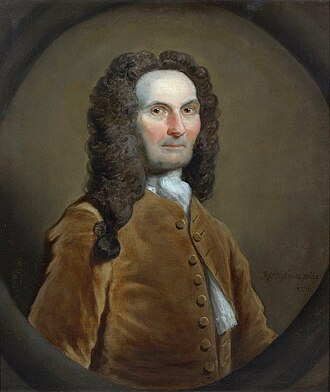
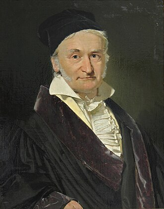
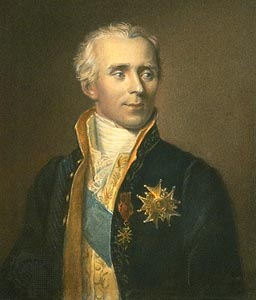

Čekání na autobus, doba mezi hovory na zákaznické lince nebo výška člověka: tři spojité veličiny a tři různé tvary hustoty. Většinu praktických situací popisuje jen několik rozdělení. Tato kapitola ukazuje tři nejdůležitější, rovnoměrné, exponenciální a normální. U každého uvádíme parametry, hustotu, distribuční funkci, střední hodnotu a rozptyl.

```{ojs}
//| echo: false
import {C, plotStyle} from "../assets/jhrules.js"
```

```{ojs}
//| echo: false
import {columnWidth, animation, drawText, clamp, ease, makeButton} from "../assets/anim.js"
```

```{ojs}
//| echo: false
// šířka textového sloupce místo vestavěné šířky celé plochy (grafy jinak přetékají doprava)
width = columnWidth(Generators)
```

```{ojs}
//| echo: false
SQRT2PI5 = Math.sqrt(2 * Math.PI)

// chyba erf (Abramowitz–Stegun 7.1.26, přesnost asi 1e-7) kvůli distribuční funkci normálního rozdělení
erf5 = (x) => {
  const s = Math.sign(x), ax = Math.abs(x), t = 1 / (1 + 0.3275911 * ax);
  const poly = ((((1.061405429 * t - 1.453152027) * t) + 1.421413741) * t - 0.284496736) * t + 0.254829592;
  return s * (1 - poly * t * Math.exp(-ax * ax));
}

cz5 = (x, d = 3) => x.toFixed(d).replace(".", ",")
```

## Rovnoměrné rozdělení

[Rovnoměrné rozdělení]{.highlight-term} $U(a,b)$ má dva parametry, začátek $a$ a konec $b$ intervalu. Všechny hodnoty na intervalu $(a,b)$ jsou „stejně možné“, hustota je vodorovná čára

$$f(x)=\frac{1}{b-a},\qquad F(x)=\frac{x-a}{b-a},\qquad a\leq x\leq b,\qquad \mu=\frac{a+b}{2},\qquad \sigma^2=\frac{(b-a)^2}{12}.$$

::: {.callout-note .zapamatuj}
## Zapamatujte si
Je to spojitá obdoba klasické pravděpodobnosti (kostky): plocha je úměrná délce intervalu. Příkladem je čekání na autobus, který jezdí v pravidelném intervalu.
:::

Obdélník s plochou $1$ může být široký a nízký, nebo úzký a vysoký.

::: {.callout-note}
## Jak číst ukázku
Nahoře je hustota, dole distribuční funkce. Zkraťte délku $b-a$: obdélník bude užší a vyšší, hustota může přesáhnout $1$, ale plocha zůstává $1$. V bodech $a$ a $b$ je hustota nespojitá: plné kolečko značí hodnotu, kterou tam funkce má, prázdné kolečko hodnotu, kterou tam nemá.
:::

```{ojs}
//| echo: false
//| classes: rez-slider-2
viewof ua5 = Inputs.range([0, 10], {step: 0.5, value: 2, label: "a (začátek)"})
viewof ud5 = Inputs.range([0.5, 10], {step: 0.5, value: 6, label: "b − a (délka)"})
```

```{ojs}
//| echo: false
//| classes: rez-440
{
  const a = ua5, b = ua5 + ud5, h = 1 / ud5;
  const xs = d3.range(-1, 21.001, 0.05);
  const pdf = (x) => x >= a && x <= b ? h : 0;
  // nespojitá hustota: úsečky, plná kolečka v krajních bodech (tam platí hodnota h), prázdná kolečka (limita 0 z druhé strany)
  const segs = [[-1, a, 0], [a, b, h], [b, 21, 0]];
  const fill = d3.range(a, b + 1e-9, Math.max((b - a) / 50, 1e-6));
  const cdf = (x) => x < a ? 0 : x > b ? 1 : (x - a) / (b - a);
  const top = Plot.plot({
    width, height: 200, style: plotStyle, marginLeft: 50,
    x: {domain: [-1, 21], label: "x"},
    y: {grid: true, domain: [0, 2.1], label: "hustota f(x)"},
    marks: [
      Plot.areaY(fill, {x: (x) => x, y: pdf, fill: C.primaryLight, fillOpacity: 0.9}),
      Plot.ruleY([0], {stroke: C.context}),
      Plot.ruleY(segs, {x1: (p) => p[0], x2: (p) => p[1], y: (p) => p[2], stroke: C.accent, strokeWidth: 2}),
      Plot.dot([[a, 0], [b, 0]], {x: (p) => p[0], y: (p) => p[1], fill: C.bg, stroke: C.accent, strokeWidth: 2, r: 4.5}),
      Plot.dot([[a, h], [b, h]], {x: (p) => p[0], y: (p) => p[1], fill: C.accent, stroke: C.accent, r: 4.5})
    ]
  });
  const bottom = Plot.plot({
    width, height: 200, style: plotStyle, marginLeft: 50,
    x: {domain: [-1, 21], label: "x"},
    y: {grid: true, domain: [0, 1], label: "distribuční funkce F(x)"},
    marks: [
      Plot.line(xs, {x: (x) => x, y: cdf, stroke: C.accent, strokeWidth: 2}),
      Plot.ruleY([0], {stroke: C.context})
    ]
  });
  // výška popisu je pevná, ať stránka neskáče při tažení posuvníků
  return html`${top}${bottom}<div style="font-size:14px;min-height:4.2em">f(x) = 1/(b − a) = ${cz5(h, 3)} na intervalu od ${cz5(a, 1)} do ${cz5(b, 1)}.
    μ = (a + b)/2 = ${cz5((a + b) / 2, 2)}, σ² = (b − a)²/12 = ${cz5(ud5 * ud5 / 12, 2)}, σ = ${cz5(Math.sqrt(ud5 * ud5 / 12), 2)}.</div>`;
}
```

## Exponenciální rozdělení

[Exponenciální rozdělení]{.highlight-term} $Exp(\lambda)$ popisuje **dobu čekání na událost**, která přichází náhodně a nezávisle (v průměru $\lambda$ za jednotku času). Má jediný parametr $\lambda$. Je to „spojitá sestra“ Poissonova rozdělení (viz [typická diskrétní rozdělení](04-prst-diskretni.qmd)): Poisson počítá **počet** událostí v intervalu, exponenciální měří **čas mezi nimi**.

$$f(x)=\lambda e^{-\lambda x},\qquad F(x)=1-e^{-\lambda x},\qquad x\geq 0,\qquad \mu=\frac{1}{\lambda},\qquad \sigma^2=\frac{1}{\lambda^2}.$$

::: {.callout-note .zapamatuj}
## Zapamatujte si: ztráta paměti
Kdo už čekal pět minut, čeká dál stejně dlouho jako na začátku. Exponenciální rozdělení „nepamatuje“, jak dlouho už čekání trvá.
:::

::: {.callout-note .priklad}
## Příklad: zákaznická linka
Hovory přicházejí nezávisle, v průměru jednou za $5$ minut, tedy $\lambda=0{,}2$. Pravděpodobnost, že další hovor přijde až po více než $5$ minutách, je $1-F(5)=e^{-1}\doteq 0{,}37$. Medián čekání je $\frac{\ln 2}{\lambda}\doteq 3{,}47$ minuty, tedy menší než průměr: rozdělení je zešikmené, dlouhé čekání se objevuje zřídka, ale zvyšuje průměr.
:::

::: {.callout-note}
## Jak číst ukázku
Modrá plocha je $F(t)$, zbytek je pravděpodobnost čekání delšího než $t$. Čárkovaná svislá čára je medián, tečkovaná průměr: zkuste průměr prodloužit a sledujte, že medián je vždy menší. V bodě $0$ hustota skočí z $0$ na $\lambda$ (plné kolečko značí hodnotu, která tam platí, prázdné limitu zleva).
:::

```{ojs}
//| echo: false
//| classes: rez-slider-2
viewof mean5e = Inputs.range([1, 10], {step: 0.5, value: 5, label: "průměr 1/λ (min)"})
viewof t5e = Inputs.range([0, 25], {step: 0.25, value: 5, label: "čas t (min)"})
```

```{ojs}
//| echo: false
//| classes: rez-300
{
  const lam = 1 / mean5e;
  const pdf = (x) => x < 0 ? 0 : lam * Math.exp(-lam * x);
  const cdf = (x) => x < 0 ? 0 : 1 - Math.exp(-lam * x);
  const xs = d3.range(0, 25.001, 0.1);
  const shade = d3.range(0, t5e + 1e-9, Math.max(t5e / 100, 1e-6));
  const med = mean5e * Math.LN2;
  const plot = Plot.plot({
    width, height: 260, style: plotStyle, marginLeft: 50,
    x: {domain: [-2, 25], label: "doba čekání x (min)"},
    y: {grid: true, domain: [0, 1.05], label: "hustota f(x)"},
    marks: [
      Plot.areaY(shade, {x: (x) => x, y: pdf, fill: C.primaryLight, fillOpacity: 0.9}),
      Plot.line(xs, {x: (x) => x, y: pdf, stroke: C.accent, strokeWidth: 2}),
      Plot.ruleX([t5e], {stroke: C.text, strokeWidth: 1.5}),
      Plot.ruleX([med], {stroke: C.context, strokeDasharray: "5,4"}),
      Plot.ruleX([mean5e], {stroke: C.context, strokeDasharray: "1,3", strokeWidth: 2}),
      Plot.ruleY([0], {stroke: C.context}),
      // v bodě 0 hustota skočí z 0 na λ: plné kolečko (hodnota platí, spojitá zprava), prázdné kolečko (limita zleva)
      Plot.ruleY([0], {x1: -2, x2: 0, stroke: C.accent, strokeWidth: 2}),
      Plot.dot([{x: 0, y: 0}], {x: "x", y: "y", fill: C.bg, stroke: C.accent, strokeWidth: 2, r: 4.5}),
      Plot.dot([{x: 0, y: lam}], {x: "x", y: "y", fill: C.accent, stroke: C.accent, r: 4.5})
    ]
  });
  // výška popisu je pevná, ať stránka neskáče při tažení posuvníků
  return html`${plot}<div style="font-size:14px;min-height:4.4em">Modrá plocha je P(X ≤ t) = F(t) = 1 − e<sup>−t/průměr</sup> = <b>${cz5(cdf(t5e))}</b>,
    zbytek P(X &gt; t) = <b>${cz5(1 - cdf(t5e))}</b>. Medián je průměr · ln 2 = ${cz5(med, 2)} min, tedy menší než průměr ${cz5(mean5e, 1)} min.</div>`;
}
```

## Normální rozdělení

[Normální rozdělení]{.highlight-term} $N(\mu,\sigma^2)$ má dva parametry, střední hodnotu $\mu$ a směrodatnou odchylku $\sigma$. Je to zvonovitá křivka symetrická kolem $\mu$ s hustotou

$$f(x)=\frac{1}{\sigma\sqrt{2\pi}}\,e^{-\frac{(x-\mu)^2}{2\sigma^2}}.$$

Zvonovitou křivku poprvé odvodil v roce 1733 jako aproximaci binomického rozdělení [Abraham de Moivre (1667–1754)]{.smallcaps}. K popisu chyb měření ji v roce 1809 použil [Carl Friedrich Gauss (1777–1855)]{.smallcaps}, proto se normálnímu rozdělení říká také Gaussovo. Proč se objevuje tak často, ukázal [Pierre-Simon Laplace (1749–1827)]{.smallcaps}: sčítá-li se mnoho malých nezávislých vlivů, výsledek se zvonu blíží.

::: {.column-margin .osobnost}


**Abraham de Moivre**
*1667 – 1754, Londýn*

Francouzský matematik, který žil v Londýně. V roce 1733 odvodil, že se binomické rozdělení při velkém počtu pokusů blíží zvonovité křivce.
<small>Portrét: Wikimedia Commons, volné dílo</small>
:::

::: {.column-margin .osobnost}


**Carl Friedrich Gauss**
*1777 – 1855, Göttingen*

Německý matematik a astronom. Zvonovitou křivku použil pro rozdělení chyb při měření drah planet.
<small>Portrét: Wikimedia Commons, volné dílo</small>
:::

::: {.column-margin .osobnost}


**Pierre-Simon Laplace**
*1749 – 1827, Paříž*

V roce 1810 dokázal první verzi centrální limitní věty, tedy proč se součty blíží normálnímu rozdělení.
<small>Portrét: Wikimedia Commons, volné dílo</small>
:::

Parametr $\mu$ **posouvá** křivku a $\sigma$ ji **roztahuje** (posun a změna měřítka). Nejčastěji se používá kvůli tomu, že ho mají veličiny, na kterých se podílí mnoho malých nezávislých vlivů (viz kapitola o lineárních kombinacích).

::: {.callout-note .zapamatuj}
## Zapamatujte si: pravidlo $\mu\pm k\sigma$
Pravděpodobnost uvnitř intervalu $\mu\pm k\sigma$ **nezávisí na $\mu$ ani $\sigma$**, jen na $k$. Změňte $\mu$ a $\sigma$ a sledujte, že plocha pro stejné $k$ zůstává stejná.
:::

::: {.callout-note .priklad}
## Příklad: výška studentů
Výška studentů má normální rozdělení s $\mu=170$ cm a $\sigma=10$ cm. Uvnitř intervalu $160$ až $180$ cm ($\mu\pm 1\sigma$) je asi $68$ % studentů, uvnitř $150$ až $190$ cm ($\mu\pm 2\sigma$) asi $95$ %.
:::

::: {.callout-note}
## Jak číst ukázku
Měňte $\mu$ a $\sigma$: křivka se posouvá a roztahuje. Pod grafem je pravděpodobnost uvnitř intervalu $\mu\pm k\sigma$. Zkuste změnit $\mu$ a $\sigma$ a ponechat $k$: pravděpodobnost se nezmění, závisí jen na $k$.
:::

```{ojs}
//| echo: false
//| classes: rez-slider-3
viewof mu5 = Inputs.range([-4, 4], {step: 0.25, value: 0, label: "μ (střed)"})
viewof sd5 = Inputs.range([0.2, 3], {step: 0.1, value: 1, label: "σ (směrodatná odchylka)"})
viewof k5 = Inputs.range([0.25, 4], {step: 0.05, value: 1, label: "k (počet σ od středu)"})
```

```{ojs}
//| echo: false
//| classes: rez-420
{
  const pdf = (x) => Math.exp(-0.5 * ((x - mu5) / sd5) ** 2) / (sd5 * SQRT2PI5);
  const xs = d3.range(-10, 10.001, 0.02);
  const lo = mu5 - k5 * sd5, hi = mu5 + k5 * sd5;
  const shade = d3.range(lo, hi + 1e-9, 0.02);
  const peak = 1 / (sd5 * SQRT2PI5);                 // vrchol hustoty
  const prob = erf5(k5 / Math.SQRT2);       // P(μ − kσ ≤ X ≤ μ + kσ) = 2Φ(k) − 1
  const plot = Plot.plot({
    width, height: 260, style: plotStyle,
    x: {domain: [-10, 10], label: "x"},
    y: {axis: null, domain: [0, Math.max(0.85, peak * 1.05)]},
    marks: [
      ...(peak > 1 ? [
        Plot.rect([{y1: 1, y2: peak * 1.05}], {x1: -10, x2: 10, y1: "y1", y2: "y2", fill: C.contextLight, fillOpacity: 0.35}),
        Plot.ruleY([1], {stroke: C.text, strokeDasharray: "5,4"}),
        Plot.text([{x: 10, y: 1}], {x: "x", y: "y", text: ["hustota = 1"], textAnchor: "end", dy: 12, fontWeight: "bold", fontSize: 11})
      ] : []),
      Plot.areaY(shade, {x: (x) => x, y: pdf, fill: C.primaryLight, fillOpacity: 0.9}),
      Plot.line(xs, {x: (x) => x, y: pdf, stroke: C.accent, strokeWidth: 2}),
      Plot.ruleX([mu5], {stroke: C.context}),
      Plot.ruleX([lo, hi], {stroke: C.text, strokeDasharray: "4,3"}),
      Plot.ruleY([0], {stroke: C.context})
    ]
  });
  // výška popisů je pevná, ať stránka neskáče při tažení posuvníků
  return html`${plot}
    <div style="font-size:14px;min-height:2.8em">P(μ − ${cz5(k5, 2)}σ ≤ X ≤ μ + ${cz5(k5, 2)}σ) = 2Φ(${cz5(k5, 2)}) − 1 = <b>${cz5(prob)}</b></div>
    <div style="font-size:13px;color:${C.context};margin-top:4px;min-height:2.8em">Pravidlo 68–95–99,7: ±1σ ${cz5(erf5(1 / Math.SQRT2), 4)} · ±2σ ${cz5(erf5(2 / Math.SQRT2), 4)} · ±3σ ${cz5(erf5(3 / Math.SQRT2), 4)}</div>
    <div style="font-size:14px;margin-top:8px;padding:6px 10px;box-sizing:border-box;min-height:5.5em;border-left:5px solid ${peak > 1 ? C.primary : "transparent"};background:${peak > 1 ? C.contextLight + "59" : "transparent"}">
      ${peak > 1 ? html`<b>Pozor:</b> pro σ = ${cz5(sd5, 1)} je vrchol hustoty ${cz5(peak, 2)}, tedy <b>větší než 1</b>. Hustota není pravděpodobnost,
      plocha pod celou křivkou je pořád 1 (křivka je jen užší a vyšší).` : html`<span style="color:${C.context}">Vrchol hustoty je ${cz5(peak, 2)}, tedy menší než 1.</span>`}</div>`;
}
```


## Standardizované normální rozdělení

Každé normální rozdělení lze převést na jedno společné, standardizované normální rozdělení $N(0,1)$. Stačí od hodnoty odečíst střední hodnotu a vydělit směrodatnou odchylkou, tedy spočítat z-skór. Opačným směrem se z z-skóru vrátíme k původní hodnotě:

$$z=\frac{x-\mu}{\sigma},\qquad x=\mu+z\sigma.$$

Je-li $X$ normální s parametry $\mu$ a $\sigma$, má $Z=\frac{X-\mu}{\sigma}$ rozdělení $N(0,1)$ s hustotou $\varphi(z)$ a distribuční funkcí $\Phi(z)$. Z-skór říká, o kolik směrodatných odchylek leží hodnota od středu, je to tedy totéž $k$ jako v pravidle $\mu\pm k\sigma$. Proč má $Z$ střední hodnotu $0$ a rozptyl $1$, vysvětluje kapitola o lineárních kombinacích.

::: {.callout-note .zapamatuj}
## Zapamatujte si
Pravděpodobnosti stačí znát pro jediné rozdělení $N(0,1)$, a to z tabulek nebo z Excelu. Pro interval od $a$ do $b$ se nejdřív převedou meze na z-skóry a pak se odečtou hodnoty $\Phi$:

$$\begin{aligned}
z_a &= \frac{a-\mu}{\sigma}, \qquad z_b = \frac{b-\mu}{\sigma},\\[4pt]
P(a\leq X\leq b) &= \Phi(z_b)-\Phi(z_a).
\end{aligned}$$
:::

::: {.callout-warning}
## Pozor: $\Phi$ není $N$, $P$ ani $Q$
$\Phi$ (velké řecké „fí“) je **distribuční funkce rozdělení $N(0,1)$**: $\Phi(z)=P(Z\leq z)$. Má vlastní symbol, protože se nedá zapsat elementárním vzorcem a její hodnoty se čtou z tabulek nebo počítají v Excelu. $N$ je jen jméno rozdělení, $P$ je pravděpodobnost jevu (číslo) a $Q$ je kvantilová funkce obecného rozdělení.
:::

Přehled značení, které se v kapitole potkává:

| Platí pro | Symbol | Co znamená | Vstup $\to$ výstup |
|:---|:---:|:---|:---|
| jakékoli rozdělení | $f(x)$ | hustota | hodnota $\to$ hustota |
| | $F(x)$ | distribuční funkce, $F(x)=P(X\leq x)$ | hodnota $\to$ pravděpodobnost |
| | $Q(p)$ | kvantilová funkce, $Q(p)=F^{-1}(p)$ | pravděpodobnost $\to$ kvantil |
| $N(0,1)$ | $\varphi(z)$ | hustota | z-skór $\to$ hustota |
| | $\Phi(z)$ | distribuční funkce, $\Phi(z)=P(Z\leq z)$ | z-skór $\to$ pravděpodobnost |
| | $\Phi^{-1}(p)$ | kvantilová funkce | pravděpodobnost $\to$ z-skór |
| | $z$ | z-skór, $z=\frac{x-\mu}{\sigma}$, zpět $x=\mu+z\sigma$ | hodnota $\leftrightarrow$ z-skór |

: Značení {#tbl-znaceni-spojita}

::: {.callout-note .priklad}
## Příklad: výška studentů
Výška studentů má rozdělení $N(170,\,10^2)$.

**Úloha 1.** Jaká je pravděpodobnost, že náhodně vybraný student bude vyšší než $190$ cm? Tedy vypočtěte $P(X>190)$.

$$\begin{aligned}
x &= 190\\
z &= \frac{x-\mu}{\sigma} = \frac{190-170}{10} = 2\\
P(X>190) &= 1-\Phi(z) = 1-\Phi(2) \doteq 0{,}023
\end{aligned}$$

**Úloha 2.** Jaká je výška, pod kterou je $95$ % studentů? Tedy najděte $q$ tak, aby $P(X\leq q)=0{,}95$.

$$\begin{aligned}
p &= 0{,}95\\
z &= \Phi^{-1}(p) = \Phi^{-1}(0{,}95) \doteq 1{,}645\\
q &= \mu+z\sigma = 170+1{,}645\cdot 10 \doteq 186{,}4
\end{aligned}$$

V Excelu: `=NORM.S.DIST(2; ANO)` a `=NORM.S.INV(0,95)`.
:::

## Srovnání tří rozdělení

Tři spojitá rozdělení se liší tvarem hustoty i tím, co popisují.

| Rozdělení | Parametry | $\mu$ | $\sigma^2$ | Typická situace |
|:---|:---:|:---:|:---:|:---|
| rovnoměrné $U(a,b)$ | $a,\ b$ | $\dfrac{a+b}{2}$ | $\dfrac{(b-a)^2}{12}$ | čekání na pravidelný spoj |
| exponenciální $Exp(\lambda)$ | $\lambda$ | $\dfrac{1}{\lambda}$ | $\dfrac{1}{\lambda^2}$ | doba mezi nezávislými událostmi |
| normální $N(\mu,\sigma^2)$ | $\mu,\ \sigma$ | $\mu$ | $\sigma^2$ | součet mnoha malých vlivů |

: Střední hodnota a rozptyl tří spojitých rozdělení {#tbl-spojita-charakteristiky}

::: {.callout-tip}
## 💡 Jak na to v Excelu?
* **Normální, hustota / distribuční funkce:** `=NORM.DIST(x; μ; σ; NE)` / `=NORM.DIST(x; μ; σ; ANO)`
* **Normální, kvantilová funkce:** `=NORM.INV(p; μ; σ)`
* **Standardizované normální:** `=NORM.S.DIST(z; ANO)` pro $\Phi(z)$, `=NORM.S.INV(p)` pro kvantil, `=STANDARDIZE(x; μ; σ)` pro z-skór
* **Exponenciální:** `=EXPON.DIST(x; λ; ANO)` pro $F(x)$, kde `λ` je převrácená hodnota průměru
* **Rovnoměrné:** Excel nemá přímou funkci, $F(x)=\frac{x-a}{b-a}$ se zapíše vzorcem.
:::

::: {.callout-note .otestujte}
## Otestujte se

Odpovězte na otázky, výsledek se ukáže hned. Odpověď můžete měnit.

```{ojs}
//| echo: false
import {kviz} from "../assets/kviz.js"
```

```{ojs}
//| echo: false
kviz([
  {
    "zadani": "Příprava jídla v bufetu trvá rovnoměrně od 2 do 8 minut."
  },
  {
    "q": "Parametry tohoto rozdělení",
    "options": [
      "a = 2 a b = 8",
      "λ = 0,2",
      "μ = 5 a σ = 6"
    ],
    "correct": 0,
    "why": "Rovnoměrné rozdělení má dva parametry: začátek a konec intervalu."
  },
  {
    "q": "Střední doba přípravy",
    "options": [
      "4",
      "5",
      "6"
    ],
    "correct": 1,
    "why": "(2 + 8) / 2 = 5 minut."
  },
  {
    "q": "Rozptyl doby přípravy",
    "options": [
      "3",
      "6",
      "36"
    ],
    "correct": 0,
    "why": "(8 − 2)² / 12 = 3."
  },
  {
    "zadani": "Zákaznická linka přijímá hovory nezávisle. Doba mezi dvěma hovory má exponenciální rozdělení s průměrem 5 minut."
  },
  {
    "q": "Parametr tohoto rozdělení",
    "options": [
      "λ = 0,2",
      "a = 0 a b = 5",
      "μ = 5 a σ = 5"
    ],
    "correct": 0,
    "why": "Exponenciální rozdělení má jediný parametr λ = 1/průměr = 0,2."
  },
  {
    "q": "P(další hovor přijde až po více než 5 minutách)",
    "options": [
      "0,37",
      "0,50",
      "0,63"
    ],
    "correct": 0,
    "why": "e⁻¹ ≈ 0,368."
  },
  {
    "q": "Hovor nepřišel 5 minut. Jak dlouho se v průměru čeká dál?",
    "options": [
      "5 minut",
      "2,5 minuty",
      "10 minut"
    ],
    "correct": 0,
    "why": "Ztráta paměti: čekání začíná znovu stejně."
  },
  {
    "q": "Medián doby čekání je",
    "options": [
      "menší než 5 minut",
      "5 minut",
      "větší než 5 minut"
    ],
    "correct": 0,
    "why": "Rozdělení je zešikmené, medián je 5 · ln 2 ≈ 3,47 minuty."
  },
  {
    "zadani": "Výška studentů prvního ročníku má normální rozdělení se střední hodnotou 170 cm a směrodatnou odchylkou 10 cm."
  },
  {
    "q": "Parametry tohoto rozdělení",
    "options": [
      "μ = 170 a σ = 10",
      "λ = 170",
      "a = 160 a b = 180"
    ],
    "correct": 0,
    "why": "Normální rozdělení má dva parametry: střední hodnotu a směrodatnou odchylku."
  },
  {
    "q": "Z-skór studenta vysokého 190 cm",
    "options": [
      "2",
      "20",
      "0,2"
    ],
    "correct": 0,
    "why": "(190 − 170) / 10 = 2."
  },
  {
    "q": "Standardizovaná veličina Z má střední hodnotu a směrodatnou odchylku",
    "options": [
      "0 a 1",
      "1 a 0",
      "μ a σ"
    ],
    "correct": 0,
    "why": "Odečteme střední hodnotu a dělíme směrodatnou odchylkou."
  },
  {
    "q": "P(160 ≤ X ≤ 180)",
    "options": [
      "asi 0,68",
      "asi 0,95",
      "asi 0,50"
    ],
    "correct": 0,
    "why": "Interval μ ± 1σ."
  },
  {
    "q": "P(X ≥ 190)",
    "options": [
      "asi 0,023",
      "asi 0,05",
      "asi 0,16"
    ],
    "correct": 0,
    "why": "190 je μ + 2σ. Mimo ±2σ je 4,6 %, vpravo polovina."
  },
  {
    "q": "Q(0,5), tedy medián výšky",
    "options": [
      "170 cm",
      "160 cm",
      "180 cm"
    ],
    "correct": 0,
    "why": "Rozdělení je symetrické, medián je ve středu."
  }
])
```
:::

::: {.callout-important}
## Klíčové poznatky
- Pravděpodobnost se vždy počítá z **distribuční funkce**, takže se nemusí integrovat: $P(a\leq X\leq b)=F(b)-F(a)$, u normálního rozdělení $\Phi(z_b)-\Phi(z_a)$
- Rovnoměrné $U(a,b)$: dva parametry, $f(x)=\frac{1}{b-a}$, $\mu=\frac{a+b}{2}$, $\sigma^2=\frac{(b-a)^2}{12}$
- Exponenciální $Exp(\lambda)$: jeden parametr, doba čekání na událost, $\mu=\frac{1}{\lambda}$, ztráta paměti
- Normální $N(\mu,\sigma^2)$: dva parametry, zvon symetrický kolem $\mu$, pravidlo $\mu\pm k\sigma$
- Značení pro obecné rozdělení: $P$ pravděpodobnost jevu, $f$ hustota, $F$ distribuční funkce, $Q$ kvantilová funkce
- Značení pro $N(0,1)$: $\varphi$ hustota, $\Phi$ distribuční funkce, $\Phi^{-1}$ kvantilová funkce, $z$ z-skór
- Standardizace $z=\frac{x-\mu}{\sigma}$ převádí libovolné normální rozdělení na $N(0,1)$
- Hustota může být větší než $1$, pravděpodobností je až plocha pod křivkou
:::
