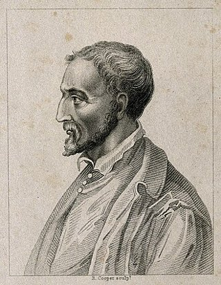

## Kde se s pravděpodobností potkáte

Mám si vsadit na to, že FC Barcelona prohraje příští zápas?

Mám zítra vyrazit na výlet do hor, abych při tom nezmoknul?

Mám se pojistit na cestu k moři, kdyby se něco stalo?

Mám nakoupit ve slevě při Black Friday, nebo je šance na výraznější zlevnění po Vánocích?

Číselně popsat šanci se jako první systematicky pokusil v 16. století italský lékař a matematik [Gerolamo Cardano (1501–1576)]{.smallcaps} ve spisu o hře v kostky.

::: {.column-margin .osobnost}

**Gerolamo Cardano**  
*1501 – 1576, Itálie*

Lékař, matematik a vášnivý hráč. Spis *Liber de ludo aleae* napsal kolem roku 1564, vyšel však až v roce 1663. Patří k nejstarším rozborům hazardních her.
<small>Portrét: Wellcome Collection, CC BY 4.0</small>
:::

Ve všech těchto případech se rozhodujeme na základě nějakých údajů a snažíme se při tom minimalizovat riziko ztráty. **Pr**avděpodobno**st** (zkráceně **prst**) je lidská snaha [číselně popsat]{.highlight}, jaká je šance, že nějaká situace nastane, abychom se mohli rozhodovat lépe.

## O čem tato část je

Nejistotu lze popsat dvěma způsoby, které se v knize neustále potkávají: **z logiky úlohy** (kolik příznivých možností je z kolika všech) a **z pozorovaných dat** (jak často se jev v opakovaných pokusech skutečně objevil). Obě pojetí se k sobě přibližují a jednotlivé kapitoly ukazují, jak a proč.

Každá kapitola začíná konkrétní otázkou, pojmy zavádí na příkladech a jednoduchých ukázkách a končí shrnutím **Klíčové poznatky**. Kapitoly na sebe navazují v pořadí, v jakém jsou v postranním panelu, ale každou lze číst i samostatně: potřebné pojmy se v ní stručně vysvětlí znovu a podrobný výklad je jen doplňkem v jiné kapitole.
