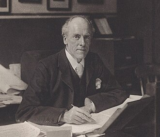
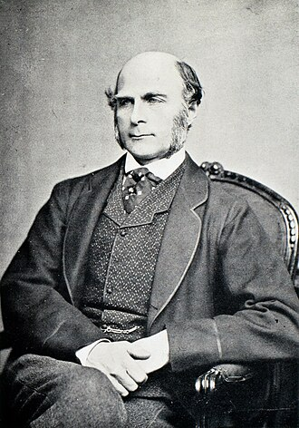

*Draft k posouzení (návrh kapitoly 5c části Pravděpodobnost, před lineárními kombinacemi).*

Dosud jsme sledovali jednu veličinu. Často nás ale zajímá dvojice: hodiny učení a body z testu, výška a hmotnost, cena a poptávka, forma studia a způsob bydlení. Dvojice veličin má vlastní rozdělení a hlavně **souvislost**: když je jedna veličina velká, bývá velká i druhá? Tato kapitola ukazuje, jak se souvislost popíše tabulkou, jak se změří u kategorií (chí-kvadrát) a u čísel (korelace) a hlavně jak souvislost mění rozptyl součtu a rozdílu dvou veličin.

```{ojs}
//| echo: false
import {C, plotStyle} from "../assets/jhrules.js"
```

```{ojs}
//| echo: false
import {columnWidth, animation, drawText, clamp, ease, makeButton} from "../assets/anim.js"
```

```{ojs}
//| echo: false
// šířka textového sloupce místo vestavěné šířky celé plochy (grafy jinak přetékají doprava)
width = columnWidth(Generators)
```

```{ojs}
//| echo: false
cz7 = (x, d = 2) => x.toFixed(d).replace(".", ",")
```

## Společné rozdělení a nezávislost

Test má dvě části, A a B. Veličina $X$ je počet správných odpovědí v části A a $Y$ v části B, obě mohou být $0$, $1$ nebo $2$. [Společné rozdělení]{.highlight-term} je tabulka pravděpodobností všech dvojic hodnot, $p(x,y)=P(X=x \text{ a } Y=y)$. Součty po řádcích a sloupcích dávají rozdělení každé veličiny zvlášť.

::: {.callout-note}
## Jak číst ukázku
Políčka tabulky jsou pravděpodobnosti $p(x,y)$ (tmavší políčko je pravděpodobnější), malým písmem pod nimi je součin $p(x)\cdot p(y)$, který by platil, kdyby veličiny byly nezávislé. Posuvník mění souvislost: při nule se obě čísla v každém políčku shodují, s rostoucí souvislostí se pravděpodobnost přesouvá na úhlopříčku, kde jsou obě části zvládnuty stejně dobře. Všimněte si, že součty řádků a sloupců se přitom nemění.
:::

```{ojs}
//| echo: false
//| classes: rez-slider-2
viewof t7 = Inputs.range([0, 1], {step: 0.05, value: 1, label: "souvislost (0 = nezávislé)"})
```

```{ojs}
//| echo: false
//| classes: rez-300
{
  // závislá tabulka D[x][y] a nezávislá tabulka I[x][y] = p(x)·p(y) se stejnými okraji
  const D = [[0.20, 0.08, 0.02], [0.08, 0.24, 0.08], [0.02, 0.08, 0.20]];
  const pm = [0.3, 0.4, 0.3];
  const p = D.map((row, x) => row.map((d, y) => (1 - t7) * pm[x] * pm[y] + t7 * d));
  const mu = (v) => d3.sum(v, (pr, i) => i * pr);
  const mx = mu(pm), sx = Math.sqrt(d3.sum(pm, (pr, i) => (i - mx) ** 2 * pr));
  const cov = d3.sum(p.flatMap((row, x) => row.map((pr, y) => (x - mx) * (y - mx) * pr)));
  const rho = cov / (sx * sx);
  const hex = (a) => Math.round(Math.min(1, a) * 255).toString(16).padStart(2, "0");
  const cell = (x, y) => html`<td style="padding:6px 14px;text-align:center;background:${C.primary}${hex(p[x][y] / 0.3)}">
      <div style="font-weight:700;font-size:16px">${cz7(p[x][y])}</div>
      <div style="font-size:11px;color:${C.context}">${cz7(pm[x] * pm[y])}</div></td>`;
  const head = html`<tr><th></th>${[0, 1, 2].map((x) => html`<th style="padding:4px 14px;text-align:center">X = ${x}</th>`)}<th style="padding:4px 14px;text-align:center;color:${C.context}">P(Y)</th></tr>`;
  const rows = [2, 1, 0].map((y) => html`<tr><th style="padding:4px 10px">Y = ${y}</th>${[0, 1, 2].map((x) => cell(x, y))}
    <td style="padding:4px 14px;text-align:center;color:${C.context}">${cz7(0.3 + (y === 1 ? 0.1 : 0))}</td></tr>`);
  const foot = html`<tr><th style="padding:4px 10px;color:${C.context}">P(X)</th>${pm.map((v) => html`<td style="padding:4px 14px;text-align:center;color:${C.context}">${cz7(v)}</td>`)}<td></td></tr>`;
  const indep = t7 === 0;
  // výška popisu je pevná, ať stránka neskáče při tažení posuvníku
  return html`<table style="border-collapse:separate;border-spacing:3px;font-size:14px">${head}${rows}${foot}</table>
    <div style="font-size:14px;min-height:3.4em;margin-top:6px">Korelace ρ = <b>${cz7(rho)}</b>.
    ${indep ? "Veličiny jsou nezávislé: v každém políčku platí p(x, y) = p(x)·p(y)." : "Veličiny jsou závislé: p(x, y) se od součinu p(x)·p(y) liší, například ve středu je " + cz7(p[1][1]) + " místo " + cz7(pm[1] * pm[1]) + "."}</div>`;
}
```

Z tabulky se čtou dva základní vztahy. Rozdělení jedné veličiny dostaneme sečtením po řádcích nebo po sloupcích a nezávislost znamená, že se každé políčko rovná součinu okrajů.

::: {.callout-note .zapamatuj}
## Zapamatujte si
$$P(X=x)=\sum_y p(x,y),\qquad X\text{ a }Y\text{ jsou nezávislé}\iff p(x,y)=P(X=x)\,P(Y=y)\text{ pro všechna }x,y.$$
:::

::: {.callout-note .priklad}
## Příklad: dvě části testu
Podle tabulky při souvislosti $1$ je $P(X=2 \text{ a } Y=2)=0{,}20$. Kdyby části byly nezávislé, bylo by to $0{,}3\cdot 0{,}3=0{,}09$. Veličiny tedy nezávislé nejsou: kdo zvládl část A, zvládne spíš i část B.
:::

## Souvislost kategorií: chí-kvadrát

U kategorií (forma studia, způsob bydlení, typ pohonu) nemáme tabulku pravděpodobností, ale tabulku **četností**: spočítáme, kolik lidí spadá do které dvojice kategorií, a četnosti odpovídají odhadům $p(x,y)$. Ptáme se stejně jako výše: je v políčkách tolik lidí, kolik by tam bylo při nezávislosti? Mezi $200$ studenty je $120$ prezenčních a $80$ kombinovaných, $60$ bydlí na koleji, $80$ v podnájmu a $60$ doma. Kdyby bydlení nezáviselo na formě studia, byla by v každém políčku [očekávaná četnost]{.highlight-term} $E$ daná podílem řádku a sloupce, třeba u prezenčních na koleji $\frac{120\cdot 60}{200}=36$. Rozdíl mezi **pozorovanou** četností $O$ a očekávanou četností $E$ se shrne do jediného čísla, [chí-kvadrát]{.highlight-term} $\chi^2$.

::: {.callout-note}
## Jak číst ukázku
Velké číslo v políčku je pozorovaná četnost $O$, malé šedé je očekávaná četnost $E$ při nezávislosti a pod nimi je příspěvek políčka $\frac{(O-E)^2}{E}$ k součtu $\chi^2$. Tmavší políčko přispívá víc. Posuvník mění souvislost: při nule je v každém políčku $O=E$, takže $\chi^2=0$, s rostoucí souvislostí se prezenční studenti přesouvají na kolej a kombinovaní domů. Součty řádků a sloupců se přitom nemění.
:::

```{ojs}
//| echo: false
//| classes: rez-slider-2
viewof tc7 = Inputs.range([0, 1], {step: 0.05, value: 1, label: "souvislost (0 = nezávislé)"})
```

```{ojs}
//| echo: false
//| classes: rez-300
{
  const rowLab = ["prezenčně", "kombinovaně"], colLab = ["kolej", "podnájem", "doma"];
  const r = [120, 80], c = [60, 80, 60], n = 200;
  const dep = [[54, 44, 22], [6, 36, 38]];                       // pozorované četnosti při plné souvislosti
  const E = r.map((ri) => c.map((cj) => ri * cj / n));            // očekávané četnosti při nezávislosti
  const O = E.map((row, i) => row.map((e, j) => e + tc7 * (dep[i][j] - e)));
  const part = O.map((row, i) => row.map((o, j) => (o - E[i][j]) ** 2 / E[i][j]));
  const chi = d3.sum(part.flat());
  const V = Math.sqrt(chi / n);                                   // menší rozměr tabulky je 2, tedy n·(2 − 1)
  const hex = (a) => Math.round(Math.min(1, a) * 255).toString(16).padStart(2, "0");
  const cell = (i, j) => html`<td style="padding:6px 14px;text-align:center;background:${C.primary}${hex(0.9 * part[i][j] / 13.5)}">
      <div style="font-weight:700;font-size:16px">${cz7(O[i][j], 1)}</div>
      <div style="font-size:11px;color:${C.context}">E = ${cz7(E[i][j], 0)}</div>
      <div style="font-size:11px">${cz7(part[i][j])}</div></td>`;
  const head = html`<tr><th></th>${colLab.map((l) => html`<th style="padding:4px 14px;text-align:center">${l}</th>`)}<th style="padding:4px 14px;text-align:center;color:${C.context}">celkem</th></tr>`;
  const rows = rowLab.map((l, i) => html`<tr><th style="padding:4px 10px">${l}</th>${[0, 1, 2].map((j) => cell(i, j))}
    <td style="padding:4px 14px;text-align:center;color:${C.context}">${r[i]}</td></tr>`);
  const foot = html`<tr><th style="padding:4px 10px;color:${C.context}">celkem</th>${c.map((v) => html`<td style="padding:4px 14px;text-align:center;color:${C.context}">${v}</td>`)}<td style="text-align:center;color:${C.context}">${n}</td></tr>`;
  // výška popisu je pevná, ať stránka neskáče při tažení posuvníku
  return html`<table style="border-collapse:separate;border-spacing:3px;font-size:14px">${head}${rows}${foot}</table>
    <div style="font-size:14px;min-height:3.4em;margin-top:6px">χ² = <b>${cz7(chi)}</b>, Cramérovo V = <b>${cz7(V)}</b>.
    ${tc7 === 0 ? "Pozorované četnosti přesně odpovídají nezávislosti: χ² je nula." : "Největší příspěvek má políčko " + rowLab[d3.maxIndex(part.flat()) < 3 ? 0 : 1] + " a " + colLab[d3.maxIndex(part.flat()) % 3] + "."}</div>`;
}
```

::: {.callout-note .zapamatuj}
## Zapamatujte si
$$E_{ij}=\frac{r_i\,c_j}{n},\qquad \chi^2=\sum_{i,j}\frac{(O_{ij}-E_{ij})^2}{E_{ij}},\qquad V=\sqrt{\frac{\chi^2}{n\,(k-1)}},$$
kde $r_i$ je součet řádku, $c_j$ součet sloupce, $n$ počet všech a $k$ menší z počtů řádků a sloupců. Platí $\chi^2\geq 0$, $\chi^2=0$ právě když je v každém políčku $O=E$, a $0\leq V\leq 1$.
:::

::: {.callout-note .priklad}
## Příklad: forma studia a bydlení
Pro prezenční studenty na koleji je $O=54$ a $E=\frac{120\cdot 60}{200}=36$, příspěvek políčka je $\frac{(54-36)^2}{36}=9$. Součet příspěvků všech šesti políček dává $\chi^2\doteq 36{,}9$ a $V=\sqrt{\frac{36{,}9}{200\cdot 1}}\doteq 0{,}43$. Souvislost je střední: prezenční studenti bydlí na koleji častěji, než by odpovídalo nezávislosti.
:::

Pojem zavedl [Karl Pearson (1857–1936)]{.smallcaps}, který v roce 1900 navrhl tuto statistiku k porovnání pozorovaných a očekávaných četností.

::: {.column-margin .osobnost}


**Karl Pearson**
*1857 – 1936, Londýn*

Britský matematik, zakladatel matematické statistiky. V roce 1900 navrhl statistiku $\chi^2$ a upravil Galtonovu korelaci do dnešního vzorce.
<small>Portrét: Wikimedia Commons, volné dílo</small>
:::

::: {.callout-warning}
## Pozor: χ² roste s velikostí souboru
Stejné procentní rozdíly při dvojnásobném souboru dají dvojnásobné $\chi^2$: při $n=400$ a stejných podílech vychází $\chi^2\doteq 73{,}9$. Proto se síla souvislosti u tabulek různé velikosti porovnává pomocí $V$, které zůstává $0{,}43$.
:::

::: {.callout-note collapse="true"}
## Pro zájemce: geometrie chí-kvadrátu
Čísla $\frac{O-E}{\sqrt{E}}$ všech políček tvoří vektor a $\chi^2$ je čtverec jeho délky, každé políčko přispívá čtvercem jedné souřadnice (Pythagorova věta). Nulový vektor znamená přesnou nezávislost. Kdy je $\chi^2$ už příliš velké na náhodné kolísání vzorku, posuzuje statistický test; ten se v této části nepočítá.
:::

## Korelace: souhra dvou veličin

Podle tabulky umíme říct, zda jsou veličiny nezávislé, ale ne **jak moc** spolu souvisejí. K tomu slouží [korelace]{.highlight-term} $\rho$, číslo od $-1$ do $1$. Ukážeme ji na skupině studentů: $X$ jsou hodiny učení týdně ($\mu_X=10$, $\sigma_X=3$) a $Y$ body z testu ($\mu_Y=60$, $\sigma_Y=12$). Každý bod v obrázku je jeden student.

::: {.callout-note}
## Jak číst ukázku
Přímky vedou přes průměry obou veličin a dělí obrázek na čtyři čtvrtiny. Modrý student je **souhlasný**: leží nad průměrem v obou veličinách, nebo pod průměrem v obou. Šedý student je nesouhlasný: v jedné je nad průměrem a v druhé pod. Zkuste $\rho=0$: modrých a šedých je zhruba stejně. Při $\rho=1$ jsou všichni modří a leží na přímce, při $\rho=-1$ jsou všichni šedí.
:::

```{ojs}
//| echo: false
//| classes: rez-slider-2
viewof rho7 = Inputs.range([-1, 1], {step: 0.05, value: 0.6, label: "ρ (korelace)"})
```

```{ojs}
//| echo: false
// 300 pevných dvojic nezávislých standardních normálních čísel (stejné při každém spuštění)
z7 = {
  const r = d3.randomLcg(21), nrm = d3.randomNormal.source(r)(0, 1);
  return d3.range(300).map(() => [nrm(), nrm()]);
}
```

```{ojs}
//| echo: false
//| classes: rez-400
{
  const pts = z7.map(([u, v]) => ({x: 10 + 3 * u, y: 60 + 12 * (rho7 * u + Math.sqrt(1 - rho7 * rho7) * v)}));
  const mx = d3.mean(pts, (d) => d.x), my = d3.mean(pts, (d) => d.y);
  const sx = Math.sqrt(d3.mean(pts, (d) => (d.x - mx) ** 2)), sy = Math.sqrt(d3.mean(pts, (d) => (d.y - my) ** 2));
  pts.forEach((d) => { d.zx = (d.x - mx) / sx; d.zy = (d.y - my) / sy; d.same = d.zx * d.zy > 0; });
  const r = d3.mean(pts, (d) => d.zx * d.zy);
  const share = d3.mean(pts, (d) => (d.same ? 1 : 0));
  const plot = Plot.plot({
    width, height: 340, style: plotStyle, marginLeft: 50,
    x: {domain: [0, 20], label: "hodiny učení týdně (X)"},
    y: {domain: [20, 100], label: "body z testu (Y)", grid: true},
    marks: [
      Plot.ruleX([10], {stroke: C.context}), Plot.ruleY([60], {stroke: C.context}),
      Plot.dot(pts, {x: "x", y: "y", r: 3, fill: (d) => d.same ? C.primary : C.context, fillOpacity: 0.65})
    ]
  });
  // výška popisu je pevná, ať stránka neskáče při tažení posuvníku
  return html`${plot}<div style="font-size:14px;min-height:3.4em">Souhlasných studentů je <b>${cz7(share * 100, 0)} %</b>.
    Průměr součinů z-skórů <i>z</i><sub>X</sub>·<i>z</i><sub>Y</sub> je <b>${cz7(r)}</b>, což je korelace souboru (zadáno ρ = ${cz7(rho7)}).</div>`;
}
```

Souhlasný student má součin z-skórů kladný, nesouhlasný záporný, a korelace je jejich průměr. Z-skór $z=\frac{x-\mu}{\sigma}$ říká, o kolik směrodatných odchylek je hodnota nad průměrem (nebo pod ním).

::: {.callout-note .zapamatuj}
## Zapamatujte si
$$z_X=\frac{x-\mu_X}{\sigma_X},\qquad z_Y=\frac{y-\mu_Y}{\sigma_Y},\qquad \rho=\text{průměr součinů } z_X\,z_Y .$$
Platí $-1\leq\rho\leq 1$. Při $\rho>0$ veličiny rostou spolu, při $\rho<0$ jedna roste, když druhá klesá, $\rho=\pm1$ znamená přesně přímkovou závislost.
:::

Pojem korelace formuloval koncem 19. století [Francis Galton (1822–1911)]{.smallcaps} při zkoumání vztahu výšky otců a synů. Jeho matematický vzorec upravil [Karl Pearson (1857–1936)]{.smallcaps}.

::: {.column-margin .osobnost}


**Francis Galton**
*1822 – 1911, Londýn*

Britský vědec. V roce 1888 popsal korelaci jako míru, s jakou spolu dvě veličiny souvisejí, a zkoumal ji na výškách otců a synů.
<small>Portrét: Wikimedia Commons, volné dílo</small>
:::

::: {.callout-warning}
## Pozor: korelace není příčina
Student s vysokým $\rho$ mezi hodinami učení a body ukazuje, že se obě veličiny pohybují spolu. Nedokazuje, že učení způsobuje lepší výsledky: může za to třeba motivace nebo předchozí znalosti.
:::

::: {.callout-warning}
## Pozor: nulová korelace neznamená nezávislost
Nezávislé veličiny mají $\rho=0$, ale obráceně to neplatí. Korelace měří jen **přímkovou** souvislost. Je-li $X$ rozloženo symetricky kolem nuly a $Y=X^2$, je $\rho=0$, přestože $Y$ je veličinou $X$ plně určeno. Rozlišujeme proto dva pojmy: veličiny jsou **nekorelované**, když nemají žádnou lineární souvislost ($\rho=0$), a **nezávislé**, když nemají žádnou souvislost vůbec. Nezávislé veličiny jsou vždy nekorelované, obráceně to platí jen výjimečně, například u dvojice s normálním rozdělením.
:::

## Kovariance a rozptyl součtu

Korelace vznikla jako průměr součinů z-skórů. Kdybychom neděleli směrodatnými odchylkami, dostaneme průměr součinů odchylek od průměrů, $(x-\mu_X)(y-\mu_Y)$, a ten se jmenuje [kovariance]{.highlight-term} $\operatorname{Cov}(X,Y)$. Je to čitatel korelace, $\rho=\frac{\operatorname{Cov}(X,Y)}{\sigma_X\sigma_Y}$. Kovariance je v jednotkách obou veličin (hodiny krát body), proto se pro srovnání používá korelace. Velký význam má tam, kde se veličiny **sčítají nebo odečítají**: ovlivňuje rozptyl součtu a rozdílu.

Test má dvě části s počtem správných odpovědí $X$ a $Y$ (tabulka výše). Celkový počet bodů je $S=X+Y$ a rozdíl mezi částmi $D=X-Y$. Rozptyl součtu se nerovná součtu rozptylů, pokud je kovariance nenulová, tedy pokud spolu části lineárně souvisejí: kdo zvládl A, zvládne i B, takže celkové skóre kolísá víc, než kdyby byly části nezávislé. Naopak rozdíl mezi částmi kolísá méně.

::: {.callout-note}
## Jak číst ukázku
Vlevo je rozdělení součtu $S=X+Y$, vpravo rozdělení rozdílu $D=X-Y$. Modré sloupce platí pro nastavenou souvislost, šedé pro nezávislé části (souvislost $0$), které slouží ke srovnání. Zvyšte souvislost: součet se rozšíří (víc pravděpodobnosti na krajích) a rozdíl se zúží na nulu. Pod obrázky je vidět, že rozptyly vycházejí stejně z rozdělení i ze vzorce s kovariancí.
:::

```{ojs}
//| echo: false
//| classes: rez-slider-2
viewof tk7 = Inputs.range([0, 1], {step: 0.05, value: 0.6, label: "souvislost (0 = nezávislé)"})
```

```{ojs}
//| echo: false
//| classes: rez-300
{
  const D = [[0.20, 0.08, 0.02], [0.08, 0.24, 0.08], [0.02, 0.08, 0.20]];
  const pm = [0.3, 0.4, 0.3];
  const joint = (t) => D.map((row, x) => row.map((d, y) => (1 - t) * pm[x] * pm[y] + t * d));
  // rozdělení funkce f(x, y) dvojice
  const dist = (p, f) => {
    const m = new Map();
    p.forEach((row, x) => row.forEach((pr, y) => m.set(f(x, y), (m.get(f(x, y)) ?? 0) + pr)));
    return m;
  };
  const varOf = (m) => { const mu = d3.sum(m, ([v, pr]) => v * pr); return d3.sum(m, ([v, pr]) => (v - mu) ** 2 * pr); };
  const p = joint(tk7), p0 = joint(0);
  const vx = varOf(dist(p, (x) => x)), vy = varOf(dist(p, (x, y) => y));
  const cov = d3.sum(p.flatMap((row, x) => row.map((pr, y) => (x - 1) * (y - 1) * pr)));
  const vS = varOf(dist(p, (x, y) => x + y)), vD = varOf(dist(p, (x, y) => x - y));
  const vS0 = varOf(dist(p0, (x, y) => x + y)), vD0 = varOf(dist(p0, (x, y) => x - y));
  const rows = (m, keys) => keys.map((v) => ({v, p: m.get(v) ?? 0}));
  const w2 = Math.max(260, Math.floor((width - 16) / 2));
  const panel = (keys, f, label) => Plot.plot({
    width: w2, height: 220, style: plotStyle, marginLeft: 40, marginBottom: 46,
    x: {type: "band", domain: keys, label},
    y: {domain: [0, 0.7], grid: true, label: "pravděpodobnost"},
    marks: [
      Plot.barY(rows(dist(p0, f), keys), {x: "v", y: "p", fill: C.contextLight}),
      Plot.barY(rows(dist(p, f), keys), {x: "v", y: "p", fill: C.primary, insetLeft: 8, insetRight: 8}),
      Plot.ruleY([0], {stroke: C.context})
    ]
  });
  // výška popisu je pevná, ať stránka neskáče při tažení posuvníku
  return html`<div style="display:flex;flex-wrap:wrap;gap:16px">${panel([0, 1, 2, 3, 4], (x, y) => x + y, "S = X + Y")}${panel([-2, -1, 0, 1, 2], (x, y) => x - y, "D = X − Y")}</div>
    <div style="font-size:14px;min-height:6em;margin-top:6px">Var(X) = ${cz7(vx)}, Var(Y) = ${cz7(vy)}, Cov(X, Y) = <b>${cz7(cov)}</b>.<br>
    Var(X + Y) = ${cz7(vx)} + ${cz7(vy)} + 2·${cz7(cov)} = <b>${cz7(vS)}</b> (nezávislé: ${cz7(vS0)}).<br>
    Var(X − Y) = ${cz7(vx)} + ${cz7(vy)} − 2·${cz7(cov)} = <b>${cz7(vD)}</b> (nezávislé: ${cz7(vD0)}).</div>`;
}
```

::: {.callout-note .zapamatuj}
## Zapamatujte si
$$\begin{aligned}
\operatorname{Var}(X+Y)&=\operatorname{Var}(X)+\operatorname{Var}(Y)+2\operatorname{Cov}(X,Y),\\
\operatorname{Var}(X-Y)&=\operatorname{Var}(X)+\operatorname{Var}(Y)-2\operatorname{Cov}(X,Y).
\end{aligned}$$
Pro nekorelované veličiny (tedy i pro nezávislé) je $\operatorname{Cov}(X,Y)=0$ a rozptyly se v obou případech sčítají. Kladná kovariance rozptyl součtu zvětšuje a rozdílu zmenšuje, záporná naopak.
:::

::: {.callout-note .priklad}
## Příklad: celkové skóre testu
Při souvislosti $1$ je $\operatorname{Var}(X)=\operatorname{Var}(Y)=0{,}6$ a $\operatorname{Cov}(X,Y)=0{,}36$. Rozptyl celkového skóre je $0{,}6+0{,}6+2\cdot 0{,}36=1{,}92$, tedy o šedesát procent víc než $1{,}2$ u nezávislých částí. Rozptyl rozdílu mezi částmi je $1{,}2-0{,}72=0{,}48$.
:::

::: {.callout-warning}
## Pozor: rozptyly se neodečítají
Rozptyl rozdílu **není** rozdíl rozptylů. Pro nekorelované veličiny, například nezávislé, je $\operatorname{Var}(X-Y)=\operatorname{Var}(X)+\operatorname{Var}(Y)$, protože odečtení jedné nejistoty od druhé nejistotu nesníží. Rozptyl rozdílu se zmenší až kladnou kovariancí.
:::

Vzorec platí i pro více veličin a pro libovolné násobky, například pro průměr; podrobněji se tím zabývá kapitola o lineárních kombinacích.

::: {.callout-note collapse="true"}
## Pro zájemce: geometrický pohled
Odchylky $n$ pozorování od průměru tvoří vektor, jeho délka je $\sigma\sqrt n$ (Pythagorova věta v $n$ rozměrech) a korelace je **kosinus úhlu** mezi vektory odchylek obou veličin. Proto leží mezi $-1$ a $1$ a nekorelované veličiny jsou na sebe kolmé. Vzorec pro rozptyl součtu je pak kosinová věta, $\sigma_{X+Y}^2=\sigma_X^2+\sigma_Y^2+2\sigma_X\sigma_Y\cos\theta$, a při kolmosti ($\rho=0$) se mění na Pythagorovu větu.
:::

::: {.callout-tip}
## 💡 Jak na to v Excelu?
* **Korelace dvou sloupců:** `=CORREL(A1:A100; B1:B100)`
* **Kovariance:** `=KOVARIANCE.P(A1:A100; B1:B100)`
* **Rozptyl součtu** ověříte porovnáním `=VAR.P(C1:C100)`, kde sloupec C je `A+B`, se součtem `=VAR.P(A1:A100)+VAR.P(B1:B100)+2*KOVARIANCE.P(A1:A100; B1:B100)`
* **Marginální pravděpodobnosti** ze společné tabulky: součet řádku `=SUMA(B2:D2)` a součet sloupce `=SUMA(B2:B4)`
* **Očekávané četnosti** v tabulce četností: `=$E2*B$5/$E$5` (součet řádku krát součet sloupce děleno celkem), příspěvek políčka `=(B2-B8)^2/B8` a $\chi^2$ jako součet příspěvků `=SUMA(B11:D12)`
:::

::: {.callout-note .otestujte}
## Otestujte se

Odpovězte na otázky, výsledek se ukáže hned. Odpověď můžete měnit.

```{ojs}
//| echo: false
import {kviz} from "../assets/kviz.js"
```

```{ojs}
//| echo: false
kviz([
  {"zadani": "Test má dvě části, A a B. Společné rozdělení počtu správných odpovědí X (část A) a Y (část B) je v tabulce.", "tabulka": [["", "Y = 0", "Y = 1", "Y = 2"], ["X = 0", "0,20", "0,08", "0,02"], ["X = 1", "0,08", "0,24", "0,08"], ["X = 2", "0,02", "0,08", "0,20"]]},
  {"q": "P(X = 2 a Y = 2)", "options": ["0,20", "0,09", "0,30"], "correct": 0, "why": "Je to přímo políčko tabulky."},
  {"q": "P(X = 1), tedy součet řádku X = 1", "options": ["0,40", "0,24", "0,08"], "correct": 0, "why": "0,08 + 0,24 + 0,08."},
  {"q": "Jsou X a Y nezávislé?", "options": ["ano", "ne"], "correct": 1, "why": "P(X=0 a Y=0) = 0,20, ale P(X=0)·P(Y=0) = 0,3 · 0,3 = 0,09."},
  {"q": "Student měl v části A 2 body. Jaká je pravděpodobnost, že měl 2 body i v části B?", "options": ["0,67", "0,20", "0,30"], "correct": 0, "why": "P(Y=2 | X=2) = 0,20 / 0,30."},
  {"zadani": "Mezi hodinami učení týdně a body z testu je korelace ρ = 0,6."},
  {"q": "Co to znamená?", "options": ["Kdo se učí víc, mívá spíš víc bodů, ne vždy.", "Každá další hodina učení přidá 0,6 bodu.", "60 % studentů uspělo."], "correct": 0, "why": "Korelace měří souhru, ne velikost změny."},
  {"q": "Z ρ = 0,6 plyne, že učení způsobuje lepší výsledky.", "options": ["ano", "ne"], "correct": 1, "why": "Korelace nedokazuje příčinu."},
  {"q": "Mezi zameškanými hodinami a body z testu očekáváte korelaci", "options": ["zápornou", "kladnou", "nulovou"], "correct": 0, "why": "Kdo víc zameškal, mívá spíš méně bodů."},
  {"q": "Korelace ρ = 0 znamená, že veličiny jsou nezávislé.", "options": ["ano", "ne"], "correct": 1, "why": "Korelace měří jen přímkovou souvislost, Y = X² má ρ = 0 přesto závisí na X."},
  {"zadani": "Z-skór ukazuje, o kolik směrodatných odchylek je student nad průměrem (kladný) nebo pod ním (záporný). Student A má z-skór +1 v učení a +2 v bodech, student B −1 a −1, student C +1 a −1."},
  {"q": "Student A přispívá ke korelaci", "options": ["kladně", "záporně"], "correct": 0, "why": "(+1)·(+2) = +2."},
  {"q": "Student B přispívá ke korelaci", "options": ["kladně", "záporně"], "correct": 0, "why": "(−1)·(−1) = +1: obě veličiny jsou pod průměrem."},
  {"q": "Student C přispívá ke korelaci", "options": ["kladně", "záporně"], "correct": 1, "why": "(+1)·(−1) = −1."},
  {"zadani": "Mezi 200 studenty je 120 prezenčních a 80 kombinovaných. Na koleji bydlí 60, v podnájmu 80 a doma 60 studentů. Prezenčních na koleji je 54."},
  {"q": "Kolik prezenčních studentů na koleji bychom čekali při nezávislosti?", "options": ["36", "54", "60"], "correct": 0, "why": "120 · 60 / 200 = 36."},
  {"q": "Jaký příspěvek má toto políčko k χ²?", "options": ["9", "18", "0,5"], "correct": 0, "why": "(54 − 36)² / 36 = 324 / 36 = 9."},
  {"q": "Hodnota χ² = 0 znamená", "options": ["pozorované četnosti přesně odpovídají nezávislosti", "veličiny jsou nezávislé v celé populaci"], "correct": 0, "why": "V souboru je v každém políčku O = E. O celé populaci to nic neříká."},
  {"q": "Stejné podíly v tabulce, ale dvakrát větší soubor. Jak se změní χ²?", "options": ["zdvojnásobí se", "zůstane stejné", "zčtyřnásobí se"], "correct": 0, "why": "Rozdíl O − E se zdvojnásobí a E také, takže (2Δ)² / (2E) = 2 · Δ² / E."},
  {"q": "Pro srovnání síly souvislosti u tabulek různé velikosti je vhodnější", "options": ["Cramérovo V", "χ²"], "correct": 0, "why": "V nezávisí na velikosti souboru a leží mezi 0 a 1."},
  {"zadani": "Veličiny X a Y (dvě části testu) mají rozptyly 0,6 a 0,6 a kovarianci 0,36."},
  {"q": "Rozptyl součtu Var(X + Y)", "options": ["1,92", "1,2", "0,48"], "correct": 0, "why": "0,6 + 0,6 + 2 · 0,36 = 1,92."},
  {"q": "Rozptyl rozdílu Var(X − Y)", "options": ["0,48", "1,2", "0"], "correct": 0, "why": "0,6 + 0,6 − 2 · 0,36 = 0,48."},
  {"q": "Kdyby X a Y byly nezávislé, Var(X + Y) by bylo", "options": ["1,2", "1,92", "0,6"], "correct": 0, "why": "Kovariance je nula: 0,6 + 0,6."},
  {"q": "Rozptyl rozdílu dvou nezávislých veličin je rozdíl jejich rozptylů.", "options": ["ano", "ne"], "correct": 1, "why": "Je to jejich součet. Odečtení jedné nejistoty od druhé nejistotu nesníží."}
])
```
:::

::: {.callout-important}
## Klíčové poznatky
- Společné rozdělení je tabulka $p(x,y)$; rozdělení jedné veličiny dostaneme součtem po řádcích nebo sloupcích
- Nezávislost: $p(x,y)=P(X=x)\,P(Y=y)$ v každém políčku
- Korelace $\rho$ je průměr součinů z-skórů: souhlasní studenti ji zvyšují, nesouhlasní snižují; $-1\leq\rho\leq1$
- $\rho=\pm1$ je přesná přímka, $\rho=0$ žádná přímková souvislost (nezávislost z toho ale neplyne)
- Korelace není příčina
- U kategorií se souvislost měří pomocí $\chi^2=\sum\frac{(O-E)^2}{E}$ s očekávanými četnostmi $E=\frac{r_i c_j}{n}$; $\chi^2$ roste s velikostí souboru, proto se síla souvislosti porovnává pomocí Cramérova $V\in\langle 0,1\rangle$
- Kovariance $\operatorname{Cov}(X,Y)$ je čitatel korelace a mění rozptyl součtu a rozdílu: $\operatorname{Var}(X\pm Y)=\operatorname{Var}(X)+\operatorname{Var}(Y)\pm2\operatorname{Cov}(X,Y)$
- Rozptyly se neodečítají, u nekorelovaných (tedy i nezávislých) veličin se sčítají i pro rozdíl
:::
