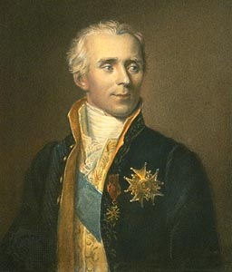

*Draft k posouzení (návrh kapitoly 6 části Pravděpodobnost).*

Doba cesty do práce je doba jízdy tramvají **plus** doba jízdy metrem. Cena objednávky je $40\cdot X$ korun za $X$ kusů **plus** poštovné. Výsledek měření je **průměr** z několika opakování. Pořád stejná otázka: když známe jednotlivé veličiny, co víme o jejich součtu, o násobku a o průměru? Obecně se ptáme na [lineární kombinaci]{.highlight-term}

$$Y = c_1X_1 + c_2X_2 + \dots + c_kX_k,$$

kde $c_i$ jsou pevná čísla (váhy) a $X_i$ jsou veličiny. Součet je $c_i = 1$, průměr $c_i = \frac{1}{n}$, rozdíl $c_1=1, c_2=-1$. V každé části nejdřív zkusíte ukázku a teprve potom se výsledek zapíše vzorcem.

```{ojs}
//| echo: false
import {C, plotStyle} from "../assets/jhrules.js"
```

```{ojs}
//| echo: false
import {columnWidth, animation, drawText, clamp, ease, makeButton} from "../assets/anim.js"
```

```{ojs}
//| echo: false
// šířka textového sloupce místo vestavěné šířky celé plochy (grafy jinak přetékají doprava)
width = columnWidth(Generators)
```

```{ojs}
//| echo: false
// hustota normálního rozdělení N(0, s²)
npdf6 = (x, s) => Math.exp(-0.5 * (x / s) ** 2) / (s * Math.sqrt(2 * Math.PI))

cz6 = (x, d = 2) => x.toFixed(d).replace(".", ",")
```

## Průměr a směrodatná odchylka

Rozdělení veličiny popisují dvě čísla. **Průměr** $\mu$ (střední hodnota) je číslo, kolem kterého hodnoty kolísají. **Směrodatná odchylka** $\sigma$ říká, o kolik se hodnoty od průměru typicky liší, a má stejné jednotky jako veličina (minuty, body, koruny). **Rozptyl** $\sigma^2$ je její druhá mocnina. V ukázkách proto sledujeme hlavně $\sigma$, rozptyl se objeví ve vzorcích.

::: {.callout-note .zapamatuj}
## Zapamatujte si
$\mu$ a $\sigma$ jsou pevná čísla rozdělení. Průměr a směrodatná odchylka vypočtené z dat jsou jen jejich odhady a při každém výběru vyjdou trochu jinak.
:::

::: {.callout-note collapse="true"}
## Pro zájemce: proč se odchylky umocňují
Odchylky od průměru nad ním a pod ním se vzájemně ruší (jejich součet je vždy nula). Proto se před zprůměrováním umocňují na druhou. Vznikne rozptyl $\sigma^2$, a protože je v „čtverečních“ jednotkách, vezme se z něj odmocnina, tedy $\sigma$. V odborné literatuře se průměr nazývá střední hodnota a značí $E(X)$, rozptyl $\operatorname{Var}(X)$.
:::

## Posun a změna měřítka

Dotazník měří spokojenost na škále $1$ až $10$. Co se stane s průměrem, rozptylem a kvantily odpovědí, když je přepočteme na jinou škálu? Každý přepočet má tvar $Y=aX+b$: nejdřív se hodnota vynásobí číslem $a$ (změna měřítka) a potom se přičte $b$ (posun).

::: {.callout-note}
## Jak číst ukázku
Horní řada je třicet odpovědí z dotazníku ($\mu=6$, $\sigma=2$), dolní řada jejich přepočet $Y=aX+b$. Oranžová svislice je průměr, světlá úsečka rozsah $\pm\sigma$, tmavé svislé značky jsou kvartily (medián tučně). Zkuste nejdřív jen posun $b$: všechno včetně kvartilů se posune o stejné číslo a šířka se nezmění. Potom jen $a$: šířka se zvětší $a$-krát, při záporném $a$ se škála obrátí. Nakonec zkuste z-skór.
:::

```{ojs}
//| echo: false
// 30 odpovědí z dotazníku na škále 1 až 10: průměr 6, směrodatná odchylka 2
// počty odpovědí 1, 2, ..., 10
base6 = {
  const counts = [1, 0, 2, 4, 5, 5, 6, 4, 2, 1];
  return counts.flatMap((k, i) => Array(k).fill(i + 1));
}
```

```{ojs}
//| echo: false
//| classes: rez-slider-2
viewof a6 = Inputs.range([-1, 1.5], {step: 0.05, value: 1, label: "a (násobek)"})
viewof b6 = Inputs.range([-5, 12], {step: 0.5, value: 0, label: "b (posun)"})
```

```{ojs}
//| echo: false
//| classes: rez-slider-2
{
  const set = (a, b) => {
    for (const [el, v] of [[viewof a6, a], [viewof b6, b]]) {
      el.value = v;
      el.dispatchEvent(new Event("input", {bubbles: true}));
    }
  };
  return html`<div style="display:flex;gap:8px;flex-wrap:wrap">
    ${Inputs.button("Původní", {reduce: () => set(1, 0)})}
    ${Inputs.button("škála 0–9", {reduce: () => set(1, -1)})}
    ${Inputs.button("obrátit škálu", {reduce: () => set(-1, 11)})}
    ${Inputs.button("z-skór", {reduce: () => set(0.5, -3)})}
  </div>`;
}
```

```{ojs}
//| echo: false
//| classes: rez-300
{
  const y = base6.map((v) => a6 * v + b6);
  const mu = d3.mean(base6), sd = Math.sqrt(d3.mean(base6, (v) => (v - mu) ** 2));
  const muY = a6 * mu + b6, sdY = Math.abs(a6) * sd;
  const quart = (vals) => {
    const s = [...vals].sort(d3.ascending);
    return [0.25, 0.5, 0.75].map((p) => d3.quantileSorted(s, p));
  };
  const qx = quart(base6), qy = quart(y);
  // stejné hodnoty se skládají nad sebe (nejvýše do osmé vrstvy)
  const stack = (vals) => {
    const seen = new Map();
    return vals.map((v) => {
      const k = v.toFixed(6), i = seen.get(k) ?? 0;
      seen.set(k, i + 1);
      return Math.min(i, 7);
    });
  };
  const sx = stack(base6), sy = stack(y);
  const bar = (m, s, row, col) => Plot.link([{x1: m - s, x2: m + s}], {x1: "x1", x2: "x2", y1: row, y2: row, stroke: col, strokeWidth: 6, strokeOpacity: 0.35});
  const quartMarks = (q, row) => [
    Plot.ruleX([q[0], q[2]], {y1: row - 0.2, y2: row + 0.2, stroke: C.text, strokeWidth: 1.5}),
    Plot.ruleX([q[1]], {y1: row - 0.2, y2: row + 0.2, stroke: C.text, strokeWidth: 4})
  ];
  const plot = Plot.plot({
    width, height: 230, style: plotStyle, marginLeft: 70,
    // pevná osa od −15 do 30: pokrývá všechny hodnoty Y při rozsahu posuvníků (Y od −15 do 27)
    x: {domain: [-15, 30], grid: true, label: null, ticks: d3.range(-15, 31, 5)},
    y: {domain: [-0.9, 1.9], ticks: [0, 1], tickFormat: (d) => d === 1 ? "původní X" : "nové Y", label: null},
    marks: [
      Plot.ruleX([0], {stroke: C.context, strokeWidth: 1.5}),
      Plot.link(base6.map((v, i) => ({x1: v, x2: y[i]})), {x1: "x1", x2: "x2", y1: 1, y2: 0, stroke: C.contextLight}),
      bar(mu, sd, 1, C.context), bar(muY, sdY, 0, C.primary),
      Plot.dot(base6, {x: (v) => v, y: (v, i) => 1 + 0.1 * sx[i], r: 4, fill: C.context}),
      Plot.dot(y, {x: (v) => v, y: (v, i) => -0.1 * sy[i], r: 4, fill: C.primary}),
      ...quartMarks(qx, 1), ...quartMarks(qy, 0),
      Plot.ruleX([mu], {y1: 0.7, y2: 1.3, stroke: C.accent, strokeWidth: 2}),
      Plot.ruleX([muY], {y1: -0.3, y2: 0.3, stroke: C.accent, strokeWidth: 2})
    ]
  });
  // výška popisu je pevná, ať stránka neskáče při tažení posuvníků
  return html`${plot}<div style="font-size:14px;min-height:6.6em">
    <b>Posun:</b> průměr ${cz6(mu, 0)} → <b>${cz6(muY)}</b>, medián ${cz6(qx[1], 1)} → <b>${cz6(qy[1], 1)}</b>.
    Při změně o <i>b</i> = ${cz6(b6, 1)} se posunou všechny hodnoty stejně.<br>
    <b>Šířka:</b> směrodatná odchylka ${cz6(sd, 0)} → <b>${cz6(sdY)}</b> (${cz6(Math.abs(a6), 2)}-krát větší),
    rozptyl ${cz6(sd * sd, 0)} → <b>${cz6(sdY * sdY)}</b> (${cz6(a6 * a6, 2)}-krát větší),
    vzdálenost kvartilů ${cz6(qx[2] - qx[0], 1)} → <b>${cz6(qy[2] - qy[0], 1)}</b>.</div>`;
}
```

Při posunu se mění jen poloha, při násobení se mění i šířka. Totéž platí pro každou hodnotu: průměr, medián i kterýkoli kvantil se posunou o $b$ a vynásobí $a$-krát, směrodatná odchylka se vynásobí $|a|$ a rozptyl $a^2$.

::: {.callout-note .zapamatuj}
## Zapamatujte si
$$\mu_Y=a\,\mu_X+b,\qquad \sigma_Y=|a|\,\sigma_X,\qquad \sigma_Y^2=a^2\,\sigma_X^2.$$
Posun $b$ mění jen polohu. Násobek $a$ změní šířku $a$-krát, rozptyl proto $a^2$-krát.
:::

::: {.callout-note .priklad}
## Příklad: převod škály dotazníku
Spokojenost na škále $1$ až $10$ má $\mu=6$ a $\sigma=2$. Převod na škálu $0$ až $9$, $Y=X-1$, dává $\mu_Y=5$ a $\sigma_Y=2$. Převod na z-skór, $Y=\frac{X-6}{2}$, tedy $a=0{,}5$ a $b=-3$, dává $\mu_Y=0$ a $\sigma_Y=1$.
:::

::: {.callout-note collapse="true"}
## Pro zájemce: zápis pomocí $E$ a $\operatorname{Var}$
V literatuře se stejný vztah píše $E(aX+b)=a\,E(X)+b$ a $\operatorname{Var}(aX+b)=a^2\operatorname{Var}(X)$.
:::

## Součet dvou veličin

Doba cesty do práce je součet doby jízdy tramvají a metrem. Průměr součtu je vždy součet průměrů, ať jsou veličiny jakkoli závislé. U kolísání je to složitější: rozptyly se sčítají u **nekorelovaných** veličin, tedy bez lineární souvislosti (patří mezi ně i nezávislé veličiny), a protože odečtení jedné nejistoty od druhé nejistotu nesníží, sčítají se i při odečítání. Pokud mezi veličinami lineární souvislost je, přibývá ještě člen s kovariancí, který se podrobně vysvětluje v kapitole o [dvou veličinách](056-prst-dve-veliciny.qmd).

::: {.callout-note .zapamatuj}
## Zapamatujte si
$$\mu_{X\pm Y}=\mu_X\pm\mu_Y,\qquad \sigma_{X\pm Y}^2=\sigma_X^2+\sigma_Y^2\quad\text{(nekorelované veličiny)}.$$
Rozptyly se sčítají, směrodatné odchylky ne: $\sigma_{X\pm Y}=\sqrt{\sigma_X^2+\sigma_Y^2}$, tedy Pythagorova věta. U veličin s lineární souvislostí přibývá člen $\pm 2\rho\,\sigma_X\sigma_Y$.
:::

::: {.callout-note .priklad}
## Příklad: cesta do práce
Tramvaj jede v průměru $20$ minut ($\sigma=3$), metro $15$ minut ($\sigma=4$), doby jsou nezávislé. Celková doba má průměr $20+15=35$ minut a $\sigma^2=9+16=25$, tedy $\sigma=5$ minut (ne $3+4=7$). Kdyby zpoždění tramvaje zdržovalo i přestup na metro (kladná souvislost), byla by $\sigma$ větší než $5$.
:::

::: {.callout-warning}
## Pozor: stačí nekorelovanost, nezávislost není potřeba
Rozptyly se sčítají, kdykoli je kovariance nulová. Veličiny přitom nemusí být nezávislé. Je-li $X$ rovnoměrně rozloženo na hodnotách $-1$, $0$ a $1$ a $Y=X^2$, je $Y$ veličinou $X$ plně určeno, ale kovariance je nula. Skutečně $\operatorname{Var}(X)=\frac23$, $\operatorname{Var}(Y)=\frac29$ a $\operatorname{Var}(X+Y)=\frac89=\frac23+\frac29$. Kovariance zachycuje jen **lineární** souvislost.
:::

## Průměr $n$ nezávislých veličin

Výsledek měření se často zpřesňuje opakováním: změří se $n$-krát a vezme se průměr. Co se stane s kolísáním průměru, když $n$ roste?

::: {.callout-note}
## Jak číst ukázku
Histogram ukazuje 1500 simulovaných průměrů z $n$ pozorování, křivka je normální rozdělení se stejným průměrem a směrodatnou odchylkou $\sigma/\sqrt n$. Zkuste zvětšovat $n$: histogram se zužuje a tvar se blíží zvonu, i když původní rozdělení zvonovité není. Zkuste všechna tři původní rozdělení.
:::

```{ojs}
//| echo: false
//| classes: rez-slider-2
sources6 = ({
  "Rovnoměrná na 0 až 10": {mu: 5, sd: 10 / Math.sqrt(12), dom: [0, 10], draw: (r) => 10 * r()},
  "Exponenciální (průměr 5)": {mu: 5, sd: 5, dom: [0, 14], draw: (r) => -5 * Math.log(1 - r())},
  "Mince (0 nebo 1)": {mu: 0.5, sd: 0.5, dom: [0, 1], draw: (r) => (r() < 0.5 ? 1 : 0)}
})

viewof src6 = Inputs.select(Object.keys(sources6), {label: "Původní rozdělení"})
viewof n6 = Inputs.range([1, 200], {step: 1, value: 1, label: "n (velikost průměru)"})
```

```{ojs}
//| echo: false
//| classes: rez-300
{
  const s = sources6[src6], M = 1500;
  const r = d3.randomLcg(5);
  const means = d3.range(M).map(() => d3.mean(d3.range(n6), () => s.draw(r)));
  const sdT = s.sd / Math.sqrt(n6);
  const lo = s.dom[0], hi = s.dom[1], nb = 40, bw = (hi - lo) / nb;
  const bins = d3.bin().domain([lo, hi]).thresholds(d3.range(lo, hi + 1e-9, bw))(means)
    .map((b) => ({x1: b.x0, x2: b.x1, h: b.length / (M * bw)}));
  const curve = d3.range(lo, hi + 1e-9, (hi - lo) / 400).map((x) => ({x, y: npdf6(x - s.mu, sdT)}));
  const plot = Plot.plot({
    width, height: 260, style: plotStyle,
    x: {domain: [lo, hi], label: "průměr X̄"}, y: {axis: null},
    marks: [
      Plot.rectY(bins, {x1: "x1", x2: "x2", y: "h", fill: C.primary, fillOpacity: 0.6, stroke: C.bg}),
      Plot.line(curve, {x: "x", y: "y", stroke: C.accent, strokeWidth: 2}),
      Plot.ruleX([s.mu], {stroke: C.context}),
      Plot.ruleY([0], {stroke: C.context})
    ]
  });
  // výška popisu je pevná, ať stránka neskáče při tažení posuvníku
  return html`${plot}<div style="font-size:14px;min-height:3.4em">n = ${n6}: σ/√n = ${cz6(s.sd)}/√${n6} = <b>${cz6(sdT, 3)}</b>,
    ve simulaci je směrodatná odchylka průměrů ${cz6(d3.deviation(means), 3)}. Šedá svislice je μ = ${cz6(s.mu)}.</div>`;
}
```

Průměr $n$ nezávislých veličin (stačí nekorelovaných) se stejným $\mu$ a $\sigma$ je lineární kombinace s vahami $\frac1n$. Z pravidel pro součet vychází

::: {.callout-note .zapamatuj}
## Zapamatujte si
$$\mu_{\bar X}=\mu,\qquad \sigma_{\bar X}=\frac{\sigma}{\sqrt n}.$$
Průměr se ustaluje na $\mu$ a kolísá s odmocninou z počtu pozorování stále méně. Čtyřikrát přesnější průměr vyžaduje šestnáctkrát víc dat.
:::

Stejný zužující se trychtýř $\pm 1/\sqrt n$ se objevuje u zákona velkých čísel: u mince je $\sigma=0{,}5$, takže $2\sigma/\sqrt n = 1/\sqrt n$. Že se průměry blíží zvonu i tehdy, když jednotlivá pozorování zvonovitá nejsou, ukázala v roce 1810 první verze [centrální limitní věty]{.highlight-term} [Pierre-Simona Laplace (1749–1827)]{.smallcaps}.

::: {.column-margin .osobnost}


**Pierre-Simon Laplace**
*1749 – 1827, Paříž*

Francouzský matematik. V roce 1810 dokázal první verzi centrální limitní věty, tedy proč se průměry a součty blíží normálnímu rozdělení.
<small>Portrét: Wikimedia Commons, volné dílo</small>
:::

::: {.callout-note collapse="true"}
## Pro zájemce: odvození
Průměr má rozptyl $n\cdot\frac{\sigma^2}{n^2}=\frac{\sigma^2}{n}$, protože každá z $n$ veličin vstupuje s vahou $\frac1n$ (umocněnou na druhou) a rozptyly nekorelovaných veličin (tedy i nezávislých) se sčítají.
:::

## Vážený průměr dvou měření

Dvěma přístroji měříme stejnou veličinu, první má chybu $\sigma_1$, druhý $\sigma_2$. Který výsledek použít, nebo jak je zkombinovat? Vážený průměr $Y=c\,X_1+(1-c)\,X_2$ dává větší váhu jednomu z nich. Chyby obou přístrojů spolu mohou souviset, což vyjadřuje korelace $\rho$ (viz kapitola o [dvou veličinách](056-prst-dve-veliciny.qmd)); u nekorelovaných (například nezávislých) chyb je $\rho=0$.

::: {.callout-note}
## Jak číst ukázku
Křivka je směrodatná odchylka kombinace v závislosti na váze $c$. Zkuste najít její minimum: leží **uvnitř** intervalu $\langle 0,1\rangle$ a je pod oběma jednotlivými chybami, když jsou chyby málo korelované. Kombinace dvou měření je tedy přesnější než kterékoli z nich. Optimum dává víc váhy přesnějšímu přístroji.
:::

```{ojs}
//| echo: false
//| classes: rez-slider-3
viewof s1_6 = Inputs.range([0.5, 3], {step: 0.1, value: 2, label: "σ₁ (1. přístroj)"})
viewof s2_6 = Inputs.range([0.5, 3], {step: 0.1, value: 1, label: "σ₂ (2. přístroj)"})
viewof rhoD6 = Inputs.range([-0.9, 0.9], {step: 0.05, value: 0, label: "ρ (korelace chyb)"})
viewof c6 = Inputs.range([-0.5, 1.5], {step: 0.01, value: 0.5, label: "c (váha 1. přístroje)"})
```

```{ojs}
//| echo: false
//| classes: rez-320
{
  const v = (c) => c * c * s1_6 ** 2 + (1 - c) ** 2 * s2_6 ** 2 + 2 * c * (1 - c) * rhoD6 * s1_6 * s2_6;
  const sd = (c) => Math.sqrt(v(c));
  const den = s1_6 ** 2 + s2_6 ** 2 - 2 * rhoD6 * s1_6 * s2_6;
  const cOpt = (s2_6 ** 2 - rhoD6 * s1_6 * s2_6) / den;
  const xs = d3.range(-0.5, 1.5001, 0.01);
  const plot = Plot.plot({
    width, height: 280, style: plotStyle, marginLeft: 50,
    x: {domain: [-0.5, 1.5], label: "váha c (1. přístroj)"},
    y: {grid: true, label: "σ kombinace", domain: [0, d3.max(xs, sd) * 1.05]},
    marks: [
      Plot.line(xs, {x: (c) => c, y: sd, stroke: C.accent, strokeWidth: 2}),
      Plot.ruleX([0, 1], {stroke: C.contextLight, strokeDasharray: "4,3"}),
      Plot.dot([{c: 0, s: s2_6}, {c: 1, s: s1_6}], {x: "c", y: "s", r: 5, fill: C.context}),
      Plot.text([{c: 0, s: s2_6}, {c: 1, s: s1_6}], {x: "c", y: "s", text: ["jen 2. přístroj", "jen 1. přístroj"], dy: -12, fill: C.context}),
      Plot.dot([{c: cOpt, s: sd(cOpt)}], {x: "c", y: "s", r: 5, fill: C.text}),
      Plot.dot([{c: c6, s: sd(c6)}], {x: "c", y: "s", r: 8, fill: C.primary})
    ]
  });
  // výška popisu je pevná, ať stránka neskáče při tažení posuvníků
  return html`${plot}<div style="font-size:14px;min-height:4.4em">Pro c = ${cz6(c6)} je σ = <b>${cz6(sd(c6), 3)}</b>
    (1. přístroj samostatně ${cz6(s1_6)}, 2. samostatně ${cz6(s2_6)}). Nejmenší možná σ = ${cz6(sd(cOpt), 3)} pro c = ${cz6(cOpt, 3)} (tmavá tečka, modrá je vaše volba c).</div>`;
}
```

::: {.callout-note .zapamatuj}
## Zapamatujte si
$$\sigma_Y^2=c^2\sigma_1^2+(1-c)^2\sigma_2^2+2c(1-c)\,\rho\,\sigma_1\sigma_2.$$
Průměr zůstává stejný. Pro $\rho=0$ jsou nejlepší váhy úměrné $1/\sigma_i^2$, přesnější přístroj má větší váhu.
:::

## Obecná lineární kombinace

Pro $Y=c_1X_1+\dots+c_kX_k$ platí vždy, že průměr kombinace je kombinace průměrů. Pro nekorelované veličiny (tedy i pro nezávislé) se rozptyly sčítají s čtverci vah.

::: {.callout-note .zapamatuj}
## Zapamatujte si
$$\mu_Y=\sum_i c_i\,\mu_i,\qquad \sigma_Y^2=\sum_i c_i^2\,\sigma_i^2\quad\text{(nekorelované veličiny)}.$$
Součet a průměr jsou jen speciální volby vah $c_i$.
:::

::: {.callout-note collapse="true"}
## Pro zájemce: závislé veličiny a maticový zápis
Pro závislé veličiny přibývá člen $2\sum_{i<j}c_ic_j\operatorname{Cov}(X_i,X_j)$. V maticovém zápisu je rozptyl kvadratická forma $\mathbf c^\top\boldsymbol\Sigma\,\mathbf c$ kovarianční matice $\boldsymbol\Sigma$.
:::

::: {.callout-tip}
## 💡 Jak na to v Excelu?
* **Průměr a rozptyl souboru dat:** `=PRŮMĚR(A1:A100)`, `=VAR.P(A1:A100)` (populační), `=VAR.S(A1:A100)` (výběrový)
* **Korelace dvou sloupců:** `=CORREL(A1:A100; B1:B100)`, kovariance `=KOVARIANCE.P(A1:A100; B1:B100)`
* **Rozptyl součtu** dvou sloupců si ověříte jako `=VAR.P(A1:A100+B1:B100)` (maticový vzorec) a porovnáním se vzorcem $\sigma_X^2+\sigma_Y^2+2\rho\sigma_X\sigma_Y$.
:::

::: {.callout-note .otestujte}
## Otestujte se

Odpovězte na otázky, výsledek se ukáže hned. Odpověď můžete měnit.

```{ojs}
//| echo: false
import {kviz} from "../assets/kviz.js"
```

```{ojs}
//| echo: false
kviz([
  {"zadani": "Dotazník měří spokojenost na škále 1 až 10 s průměrem 6 a směrodatnou odchylkou 2. Odpovědi se převedou vzorcem Y = 5X − 5."},
  {"q": "Průměr Y", "options": ["25", "30", "5"], "correct": 0, "why": "5 · 6 − 5 = 25."},
  {"q": "Směrodatná odchylka Y", "options": ["2", "10", "25"], "correct": 1, "why": "|a| · σ = 5 · 2. Posun −5 směrodatnou odchylku nemění."},
  {"q": "Z-skór odpovědi 8", "options": ["1", "2", "0,5"], "correct": 0, "why": "(8 − 6) / 2 = 1."},
  {"zadani": "Cesta do práce: tramvaj trvá v průměru 20 minut (σ = 3), metro 15 minut (σ = 4), doby jsou nezávislé."},
  {"q": "Průměrná doba celé cesty", "options": ["35 minut", "5 minut", "300 minut"], "correct": 0, "why": "Průměr součtu je součet průměrů."},
  {"q": "Směrodatná odchylka celé cesty", "options": ["5 minut", "7 minut", "25 minut"], "correct": 0, "why": "σ² = 9 + 16 = 25, σ = √25 = 5."},
  {"q": "Doby by spolu kladně souvisely (tramvaj se zpozdí a metro také). Směrodatná odchylka celé cesty by byla", "options": ["větší než 5", "menší než 5", "stejná, 5"], "correct": 0, "why": "Kladná souvislost přidává člen 2ρσ_Xσ_Y, takže rozptyl je větší než součet rozptylů."},
  {"q": "Rozptyl rozdílu dob (tramvaj − metro)", "options": ["25", "7", "1"], "correct": 0, "why": "U nezávislých veličin se rozptyly sčítají i při odečítání."},
  {"zadani": "Laboratoř měří koncentraci látky. Jedno měření má směrodatnou odchylku 2 mg/l, měření jsou nezávislá."},
  {"q": "Směrodatná odchylka průměru ze 4 měření", "options": ["1 mg/l", "0,5 mg/l", "2 mg/l"], "correct": 0, "why": "σ / √n = 2 / 2 = 1."},
  {"q": "Kolik měření je třeba, aby byla směrodatná odchylka průměru poloviční než u jednoho měření?", "options": ["2", "4", "8"], "correct": 1, "why": "σ / √n = σ / 2 vyjde pro n = 4."},
  {"zadani": "Veličinu měří dva nezávislé přístroje se směrodatnými odchylkami σ₁ = 2 a σ₂ = 1. Měření se zkombinuje váženým průměrem."},
  {"q": "Optimální váha 1. (méně přesného) přístroje", "options": ["0,2", "0,5", "0,8"], "correct": 0, "why": "σ₂² / (σ₁² + σ₂²) = 1 / 5."},
  {"q": "Směrodatná odchylka takového průměru je", "options": ["menší než obě σ", "mezi 1 a 2", "větší než 2"], "correct": 0, "why": "√(0,2² · 4 + 0,8² · 1) = √0,8 ≈ 0,89."}
])
```
:::

::: {.callout-important}
## Klíčové poznatky
- Posun a násobek: $\mu_Y=a\mu_X+b$, $\sigma_Y=|a|\sigma_X$, $\sigma_Y^2=a^2\sigma_X^2$; posun mění jen polohu, násobek šířku
- Součet: $\mu_{X+Y}=\mu_X+\mu_Y$ vždy; u nekorelovaných veličin (tedy i nezávislých) se rozptyly sčítají (i pro rozdíl), $\sigma_{X\pm Y}^2=\sigma_X^2+\sigma_Y^2$, u veličin s lineární souvislostí přibývá člen s kovariancí
- Geometricky: u nekorelovaných veličin se směrodatné odchylky skládají jako odvěsny pravoúhlého trojúhelníku (Pythagorova věta)
- Průměr $n$ nezávislých pozorování: $\sigma_{\bar X}=\sigma/\sqrt n$, zvon se zužuje a blíží se normálnímu rozdělení
- Vážený průměr dvou měření může být přesnější než kterékoli z nich, optimální váhy dávají víc váhy přesnějšímu
:::
