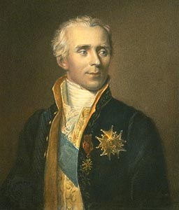
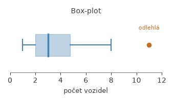
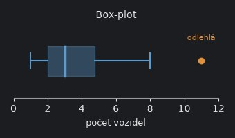

# Psaní a úprava kapitol: forma, osobnosti, kvíz, příklady

Platí pro všechny nové i upravované kapitoly. Barvy bloků, nadpisy a kvíz jsou technicky popsané v `bloky-a-tmavy-rezim.md`,
animace v `animace-konvence.md`. Tady je to, co spojuje kapitolu do jednoho stylu. Nemusí se to znovu ladit.

## Cílová skupina a příklady

- Studenti ekonomiky, managementu, datové vědy, pedagogiky a podobně. Příklady musí rozumět každý.
- Používat zkušenosti, které mají všichni: škola a studium (třída, obor, kolej, test, zápočet), bydlení a nájem, lékař a ordinace,
  pojištění (cesty, úrazy, nehody), práce a mzdy, kavárna a obchod, výroba (vadné kusy), losování, mince, kostky, karty.
- **Nestavět vše na autech.** Část čtenářů auta odmítá a náhodný výběr auta v půjčovně se v praxi nedělá. Auta jen tam, kde to sedí
  (typy proměnných: typ pohonu má benzín, naftu, elektro **i hybrid**).
- Mince: **líc a rub** (ne panna a orel, ne hlava a lev), platí pro koruny i eura.
- Čísla v příkladech se vždy spočítají (Python), kvíz i text musí sedět.

## Kapitola je samonosná

- Každá kapitola se dá číst samostatně. **Nepředpokládat znalost jiné kapitoly** a nepsat „jak jste počítali“, „jak už víte“, „připomeňme“,
  „stejně jako v kapitole o …“, „viz předchozí kapitola“. Potřebný pojem se krátce vysvětlí znovu, přímo v textu.
- Slova „předchozí“, „další“, „následující“, „dřívější“ kapitola se nepoužívají (pořadí kapitol se mění). Píše se jen „kapitola o …“.
- Odkazy na jiné kapitoly jsou **pasivní doplněk** („Podobný výpočet se dělá v deskriptivní statistice“, „viz kapitola o …“), nikdy podmínka pochopení.
  Text kolem odkazu musí dávat smysl, i když čtenář neklikne.
- Při přesunu draftu do knihy odkazy přepsat na skutečné soubory a z hlavičky odstranit poznámku „Draft k posouzení“.

## Stavba kapitoly

1. Úvodní odstavec s konkrétní otázkou, potom sekce `##`.
2. Po každém nadpisu **text**, nikdy hned callout, kód ani tabulka. Úroveň `###` se nepoužívá.
3. Pojem při definici `[pojem]{.highlight-term}`, jeden definiční výskyt v knize.
4. Důležité pravidlo nebo vzorec: callout **Zapamatujte si**. Častý omyl: **Pozor**. Konkrétní čísla: **Příklad**. Omezení: **Upozornění**.
5. Ukázky (OJS): před nimi callout **Jak číst ukázku** (Poznámka), viz pravidla níže.
6. Příklad s více částmi: nejdřív úvodní příklady, potom tabulka pojmů, potom pojmy použité na těch příkladech, teprve pod tím další příklady (rozbalovací).
7. Na konci: **Otestujte se**, potom **Klíčové poznatky** (callout-important), případně Reference. Bez nadpisu `## Shrnutí`.

### Rozbalovací bloky (`collapse="true"`)

Rozbalovat jen to, co lze přeskočit bez ztráty smyslu: odvození, pokročilé varianty, zdroje, dlouhé texty, rozšíření pro zájemce
(například negativně binomické rozdělení). Nerozbalovat vzorové příklady, které učí postup, ani Zapamatujte si, Pozor a Klíčové poznatky.
Text, na který se odkazuje tabulka nebo další výklad, se nerozbaluje.

### Callout „Jak číst ukázku“

- Nad interaktivní ukázkou **nikdy nepsat „Jak ovládat ukázku“**: že lze tlačítka a posuvníky ovládat, je samozřejmé. Obecné ovládání (Plynule, Pauza, +1, +10, +100, Restart) je jednou v `index.qmd`.
- Titulek je **„Jak číst ukázku“** (případně „Co ukázka ukazuje“). Text je krátký (2 až 4 věty) a říká **co se v obrázku děje** (barvy, osy, co je teorie a co data)
  a **co má čtenář zkusit a čeho si všimnout**: „Zkraťte délku: obdélník bude užší a vyšší.“, „Zkuste zmenšit urnu, rozdíl mezi variantami roste.“, „Změňte $\mu$ a $\sigma$ a ponechte $k$: pravděpodobnost se nezmění.“
- Popis jednotlivých tlačítek jen tam, kde není zřejmý (například tlačítko **B**, které zúží vesmír na jev $B$), a jednou větou.

## Jména osob a osobnosti v okraji

- V textu je jméno vždy kapitálkami s roky: `[Jméno (1749–1827)]{.smallcaps}` (pomlčka mezi roky). Styl je v `hag_custom.scss` (`.smallcaps`).
- Na každé stránce má být aspoň jedna historická osobnost (klidně i moderní, pokud je portrét s volnou licencí).
  V textu vždy věta, proč tam osoba je („tento pojem zavedl …“). Karta se vkládá **za** odstavec s touto větou, ne hned za nadpis:

```
::: {.column-margin .osobnost}


**Pierre-Simon Laplace**  
*1749 – 1827, Paříž*

Dvě až tři věty o tom, čím se proslavil.
<small>Portrét: Wikimedia Commons, volné dílo</small>
:::
```

- Portréty jsou **uložené v `assets/portrety/`** (jpg, šířka 320 px), nikdy jen odkaz na web. Stahuje je
  `docs_for_agents/skripty/stahni-portret.py` (jen Public domain a CC0, server omezuje dotazy, skript čeká).
  Zdroj v kartě: `Portrét: Wikimedia Commons, volné dílo`. Licence CC BY (například Wellcome Collection) jen s uvedením zdroje a se souhlasem autora.
- Data o osobě (roky, díla) ověřit, nevymýšlet. Citáty nepsat, pokud je nelze doložit.
- **Když volný portrét není:** karta bez fotografie, ale s ilustrací principu ve dvou variantách (světlá a tmavá),
  vytvořenou skriptem `docs_for_agents/skripty/ilustrace.py` (jpg do `assets/portrety/`):

```
{.light-content}

{.dark-content}
...
<small>Portrét není dostupný pod volnou licencí</small>
```

## Kvíz „Otestujte se“

- Technika: `assets/kviz.js`, zápis a rozložení v `bloky-a-tmavy-rezim.md`. Rozložení zadání | odpovědi | výsledek.
- Otázky jsou **praktické**, bez umělého natahování, počet není pevný (5 až 10 podle látky). Delší zadání příkladu (`zadani`, volitelně `tabulka`)
  a k němu několik otázek. Každý scénář z jiného prostředí (škola, lékař, pojišťovna, výroba), ne pořád stejný.
- Správná odpověď má v `why` stručný výpočet nebo důvod. Špatné distraktory odpovídají typickým chybám (součin místo součtu, nezávislost místo neslučitelnosti).
- **Rozdělení pravděpodobnosti:** po výběru typu se ptáme na parametry se správným počtem: binomické n a π (2), geometrické π (1),
  hypergeometrické N, M a n (3), Poissonovo λ (1). Mezi odpověďmi jsou i sady s nesprávným počtem parametrů. Negativně binomické se v kvízu neptá.
- Text otázek je prostý text (bez LaTeXu), vzorce Unicode znaky.
- Typy proměnných: do bloku patří i ukázka „Určete typ proměnné u každé položky“.

## Technická upozornění při úpravách

- LaTeX v Python řetězcích: `\b`, `\f`, `\a`, `\t` se rozpadnou na řídicí znaky. Vzorce vkládat nástrojem Edit/Write, nebo v Pythonu jen v raw
  řetězci, a po úpravě zkontrolovat řídicí znaky (kódy pod 32 kromě konců řádků).
- Soubory kapitol mají CRLF. Při úpravě skriptem zachovat konce řádků. Před commitem `quarto render` bez varování.
- Při každém vložení fenced divů (`:::`) zkontrolovat vyváženost (každý otevřený je zavřený) a prázdný řádek před `:::`.
- Obrázky do kapitol dávat do `assets/`, cesta je relativní k souboru kapitoly (`../assets/...`, v `index.qmd` bez `../`).
