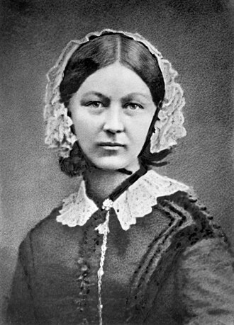

# Úvodní poznámky {.unnumbered}

Na této stránce se budou objevovat zdroje a materiály vhodné k pochopení základních i pokročilejších myšlenek z různých obastí. Stránky tedy nejsou rigorózní  učebnicí, jsou zaměřené na **vizualizaci základních myšlenek a ideí**, od které jsou přesné definice, věty a algorimty odvozené. 

Autor čerpá inspiraci z různých zdrojů, z některých tu dobrou a z nkterých i tu, kterou zde používat nebudeme. Pro pochopení základních pojmů a ideí doporučuji také následující zdroje: 

Na stránce **Betterexpleined** ukazuje [@azad_betterexplained]  vizuálně pěkně jednotlivé matematické koncepty od běžných operací s čísly přes maticový počet po komplexní čísla a používá velmi srozumitelnou angličtinu.

Na stránce **stats.libretext** je volně dostupné větší množství materiálů o statistice a pravděpodobnosti. Doporučuji zejména [@grinstead2012introductory], který  má velmi pěkně vysvětlenou teorii pravděpodobnosti, zvláště markovovy řetězce. 

další přibudou později ...

## Jak číst obrázky a ukázky

Že dobrý obrázek řekne víc než tabulka čísel, ukázala již v 50. letech 19. století [Florence Nightingale (1820–1910)]{.smallcaps}, která úmrtnost vojáků v krymské válce znázornila kruhovými diagramy a přesvědčila s nimi úřady o nutnosti zlepšit hygienu.

::: {.column-margin .osobnost}

**Florence Nightingale**  
*1820 – 1910, Londýn*

Britská ošetřovatelka a statistička, průkopnice vizualizace dat. Jako první žena byla přijata do Královské statistické společnosti.
<small>Portrét: Wikimedia Commons, volné dílo</small>
:::

::: {.callout-note}
## Význam barev v ukázkách
Interaktivní ukázky používají v celé knize stále stejné barvy:

- **modrá** je to, co se skutečně pozorovalo nebo nasimulovalo (hody, výběry, četnosti z dat),
- **oranžová** zvýrazňuje to, na co se právě soustředíte, nejčastěji teoretickou hodnotu, ke které se pozorování blíží,
- **šedá** je kontext, tedy to, co zrovna není předmětem pozornosti (u skupin je šedá druhá a tmavší šedá třetí skupina),
- **cihlově červená** označuje chybu nebo špatnou odpověď.

Pokud některá ukázka z tohoto pravidla vybočí, text u ní to vždy řekne.
:::

::: {.callout-note}
## Ovládání ukázek
Ukázky můžete pouštět plynule (**Plynule** / **Pauza**), nebo po krocích tlačítky **+1**, **+10** a **+100**, a vždy je lze vrátit na začátek tlačítkem **Restart**. Prvních několik kroků stojí za to sledovat pomalu, protože v nich je vidět celý princip. S rostoucím počtem pokusů se pozorování uklidňuje a blíží se teorii.
:::

## Jak číst bloky v textu

Text je rozdělen do barevně odlišených bloků, aby se v něm dalo snadno orientovat:

::: {.callout-note .zapamatuj}
## Zapamatujte si
Pravidlo, definice nebo vzorec, který stojí za to znát zpaměti.
:::

::: {.callout-note .priklad}
## Příklad
Konkrétní situace s čísly, na které se dá pojem nebo vzorec vyzkoušet.
:::

::: {.callout-warning}
## Pozor
Častý omyl nebo záludnost, na které se snadno chybuje.
:::

::: {.callout-caution}
## Upozornění
Omezení nebo souvislost, která se hodí vědět, ale není tak zásadní jako předchozí varování.
:::

::: {.callout-note}
## Poznámka
Vysvětlení k ukázkám, doplňující informace nebo upřesnění.
:::

::: {.callout-note .otestujte}
## Otestujte se
Krátký kvíz s okamžitou zpětnou vazbou.
:::

::: {.callout-important}
## Klíčové poznatky
Shrnutí na konci kapitoly.
:::

Rozbalovací bloky obsahují podrobnosti (odvození, další příklady), které nejsou pro pochopení nezbytné.

J.Haviger, 2025

*Tato stránka je založená na quarto book stylu s využitím OJS.* 